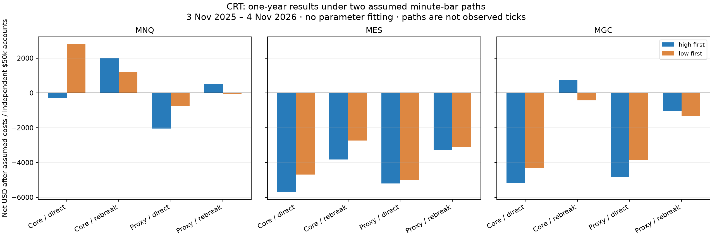

# CRT transcript profitability audit

Completed on 5 November 2026. Evaluation: **3 November 2025 through 4 November 2026**, with earlier data for warmup. The supplied Massive key provided minute bars; requests for one-second aggregates and historical trades each returned HTTP 403. No subscription was changed.

The study used **1,089,132 minute bars across 17 dated contracts and 4,828 exchange schedule events**. It compares all 24 predeclared cases: three instruments × two entry methods × mechanical/proxy filters × two assumed OHLC orderings. Parameters were fixed before the annual run; they were not optimized for profit.

## What the test says

Across the 12 instrument/rule combinations, 1 were profitable under both assumed paths, 8 lost under both, and 3 changed sign. These two paths are sensitivities, not observed trade histories or rigorous profit bounds. The maximum simulated net-positive win rate across all cases was 52.3%; the highest target-hit rate before considering whether fees consumed the profit was 53.3%. Neither reproduced the advertised 70–80%. The illustrative daily-block 95% bootstrap interval crossed zero in 12 of 24 cases.

This can identify mechanical variants that made money **in the tested simulations**. It cannot establish that the trader's full discretionary approach is profitable: the transcripts do not give an objective algorithm for hourly levels, rejection strength, chop, news selection, or switching between direct and rebreak entries. The proxy cases test our approximation of those decisions, not a verified record of his trades.

## All results after assumed costs

Dollar ranges below are the results of high-first and low-first minute paths. Each instrument has an **independent $50,000 simulated account**, at most $100 planned risk per trade, whole micro contracts, and a maximum of ten contracts. The scenarios are alternatives and must not be added together. The global two-trade daily cap is applied separately to each instrument account.

| Instrument | Filters | Entry | Simulated trades | Win rate | Net P&L | Net at higher fees |
|---|---|---|---:|---:|---:|---:|
| MNQ | Mechanical | direct | 302 | 46.7% to 52.3% | −$296 to +$2,802 | −$2,295 to +$803 |
| MNQ | Mechanical | rebreak | 169 | 47.9% to 50.9% | +$1,197 to +$2,018 | +$357 to +$1,157 |
| MNQ | Bias/chop proxy | direct | 176 | 42.0% to 46.0% | −$2,040 to −$755 | −$3,232 to −$1,948 |
| MNQ | Bias/chop proxy | rebreak | 108 to 115 | 44.4% to 47.0% | −$59 to +$499 | −$644 to −$121 |
| MES | Mechanical | direct | 305 | 39.0% to 40.7% | −$5,689 to −$4,688 | −$8,132 to −$7,131 |
| MES | Mechanical | rebreak | 206 to 216 | 36.4% to 39.4% | −$3,826 to −$2,736 | −$5,256 to −$4,217 |
| MES | Bias/chop proxy | direct | 157 | 31.8% to 33.1% | −$5,207 to −$4,994 | −$6,546 to −$6,333 |
| MES | Bias/chop proxy | rebreak | 106 to 112 | 31.1% to 33.0% | −$3,273 to −$3,112 | −$4,064 to −$3,944 |
| MGC | Mechanical | direct | 303 to 304 | 38.3% to 39.8% | −$5,196 to −$4,325 | −$6,932 to −$6,074 |
| MGC | Mechanical | rebreak | 207 to 214 | 43.5% to 46.3% | −$422 to +$739 | −$1,418 to −$250 |
| MGC | Bias/chop proxy | direct | 158 | 30.4% to 33.5% | −$4,847 to −$3,847 | −$5,691 to −$4,691 |
| MGC | Bias/chop proxy | rebreak | 102 to 109 | 38.2% to 39.4% | −$1,303 to −$1,060 | −$1,754 to −$1,531 |



Base fees are an **assumed $0.85 per side per contract**, with one adverse tick at entry and market/stop exits. Higher fees reprice the same fills at $1.50 per side; they do not resimulate order sizing. Gross P&L, fee totals and commission break-even points are in the summary JSON. No broker margin model is included.

## Chronological stability of rebreak entries

The split below was declared before this annual run. It is a descriptive chronology comparison, not a clean unseen holdout: earlier work had already inspected part of September–November 2026. No rules were fitted on either side of the split.

| Instrument | Filters | 3 Nov 2025–30 Jun 2026 | 1 Jul–4 Nov 2026 |
|---|---|---:|---:|
| MNQ | Mechanical | −$660 to −$245 | +$1,856 to +$2,263 |
| MNQ | Bias/chop proxy | −$121 to +$165 | +$62 to +$333 |
| MES | Mechanical | −$1,851 to −$1,035 | −$1,975 to −$1,702 |
| MES | Bias/chop proxy | −$1,555 to −$1,297 | −$1,976 to −$1,557 |
| MGC | Mechanical | −$1,211 to −$189 | +$788 to +$928 |
| MGC | Bias/chop proxy | −$1,033 to −$686 | −$374 to −$270 |

## Fidelity and limitations

- C1/C2 are adjacent completed 15/30/60-minute candles. C2 sweeps one C1 extreme and closes inside C1; double sweeps are excluded. Entry must occur during C3, one tick past C2's opposite extreme. Target is C1's opposite extreme; stop distance is reward / 1.5, rounded down to valid ticks. Pending setups expire with C3.
- Entry windows are 09:30–12:00 and 20:00–22:00 New York time, with DST. First qualified setup per instrument/session, maximum two entries per CME trading date. Positions otherwise retain their bracket, with daily/exchange-close liquidation for operational reasons.
- Mechanical cases disable invented quantitative bias/chop thresholds and permit the first setup without a directional bias, a simplified variation discussed in the interview. Proxy cases add the pre-existing, documented hourly/chop approximation. They share the same minimum one-tick stop/target eligibility, actual bracket rounding, sizing and costs.
- Minute bars do not show the real intrabar sequence. We explicitly simulate both open→high→low→close and open→low→high→close, allowing same-minute entries, rebreaks and exits. Additional oscillations, actual queue priority, partial fills, latency and bid/ask spreads remain unobserved.
- Fixed calendar rolls were specified in advance: equity index contracts switch at 18:00 New York seven calendar days before the third Friday of the delivery quarter; gold switches seven days before the delivery month. This is a research convention, not volume-based front-month selection. Prices are not back-adjusted. Signal history resets at a roll, so hourly filters must warm up again.
- Missing minute bars are not fabricated. The downloader uses dated futures, not spot prices or an adjusted continuous series. File hashes and contract windows are retained in the summary.
- The account-wide $2,000 permanent drawdown stop is disabled for the study so it does not censor the strategy sample. The daily risk/trade rules and whole-contract constraints remain. A losing case may therefore exceed the application's default permitted drawdown.
- Confidence intervals resample weekdays as daily blocks, including zero-trade days and holidays. They assume independent daily blocks and do not account for longer regime dependence, multiple comparisons, discretionary-model uncertainty, or uncertainty about actual intrabar paths. Win-rate Wilson intervals likewise do not account for dependence.

## Correction to the original report

The initial legacy backtest incorrectly omitted entry-minute targets and could cancel valid rebreak winners using a later minute high/low. Its −$959.45 / 19% win result is **superseded and unsuitable as profitability evidence**. On that same shorter sample, with its original filters and sizing, corrected high-first execution returned +$16.25 across 33 trades, and low-first returned −$53.45 across 32 trades. The wider annual study above uses independently declared mechanical and proxy cases and must not be conflated with that initial portfolio.

## Reproduce and inspect

```powershell
.\.venv\Scripts\python.exe -m pip install -e ".[research,test]"
.\.venv\Scripts\python.exe -m research.download_annual
.\.venv\Scripts\python.exe -m research.annual_study
.\.venv\Scripts\python.exe -m research.summarize_study
Start-Process .\runs\annual_audit\report.html
```

The detailed local report is `runs/annual_audit/report.html`, with per-case trade CSVs, equity samples and event logs in subdirectories. [The machine-readable summary](research/results/annual_summary.json) contains all cases, monthly results, uncertainty estimates, path-sensitive trade counts and SHA-256 input hashes. The protocol hash is `47d7a89f3b0e6853aa3faddafa7a5df955369ddf36bd22a9fc22d109d338846b`.

Contract mechanics were checked against [CME's Micro E-mini FAQ](https://www.cmegroup.com/articles/faqs/micro-e-mini-equity-index-futures-frequently-asked-questions.html) and [gold product overview](https://www.cmegroup.com/education/courses/event-contracts-underlying-markets/product-gold). Data access was checked using [Massive's aggregate documentation](https://massive.com/docs/rest/futures/aggregates) and [historical trades documentation](https://massive.com/docs/rest/futures/trades-quotes/trades). Finer-data access was tested directly and refused by the supplied key.
