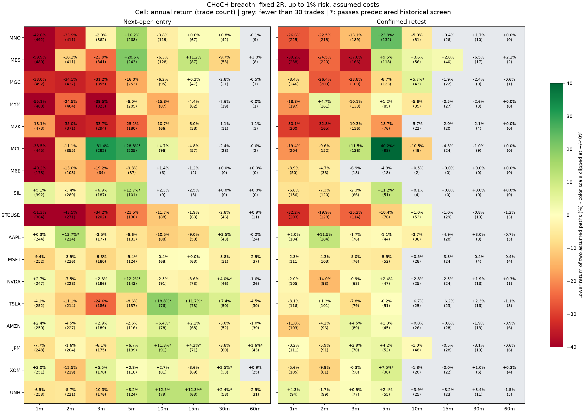

# CHoCH breadth: more timeframes, futures, BTC spot and single stocks

Period: **3 November 2025 through 4 November 2026**. Completed **544 / 544** declared simulations: 17 assets, eight timeframes, two entry methods and two assumed minute-price paths. These are overlapping, dependent cases, not 544 independent tests. All 24 original futures 5m/15m control cases matched their prior results.

The target stays at 2R, with the same strict 2-left/2-right confirmed swings, defined trend, frozen structural stop, first eligible signal per session, three-candle retest expiry and next-minute entry. Five minutes remains the prior reference; the expanded grid does not select a newly optimized strategy.

**The tested strategy is not broadly consistent across assets and timeframes.** Only 5 of the 75 sufficiently sampled primary retest combinations pass the historical screen; 61 others have fewer than 30 trades. MNQ retest returns change from -26.6%, -22.5% and -13.1% at 1m/2m/3m to +23.9% at 5m and -5.0% at 10m. The profitable settings are narrow historical pockets that need independent future validation.

BTC spot passes at no timeframe: its retest returns are -10.44% at 5m and +0.97% at 10m, with the latter failing the profit-factor and time-block requirements. Among the selected stocks, only XOM 5m passes the primary retest screen. Immediate next-open entries have 14 passes, 100 failures and 22 insufficient samples out of 136 combinations; these are controls on the same inspected year, not independent validation or a reason to switch to the best observed setting.

## Primary confirmed-retest results

The cell is the **lower total return of the two price paths** after modeled costs. An asterisk means the combination passed the historical screen. `(small)` means fewer than 30 trades in at least one path; its return is not dependable evidence. All accounts start independently at $50,000, compound and target up to 1% planned risk; do not sum these returns as a portfolio.

Stock and BTC positions are capped at 1x equity notional. They often use less than the available 1% risk, so raw returns across these assets and futures are not comparisons at matched leverage or volatility. Mean planned risk is shown in the detailed table.

| Asset | 1m | 2m | 3m | 5m | 10m | 15m | 30m | 60m |
|---|---:|---:|---:|---:|---:|---:|---:|---:|
| MNQ | -26.6% | -22.5% | -13.1% | +23.9%* | -5.0% | +0.4% (small) | +1.7% (small) | +0.0% (small) |
| MES | -39.2% | -24.5% | -37.0% | +9.5% | +3.6% | +2.0% | -6.5% (small) | +2.1% (small) |
| MGC | -8.4% | -26.4% | -23.8% | -8.7% | +5.7%* | -1.9% (small) | -2.4% (small) | -0.6% (small) |
| MYM | -18.8% | +4.7% | -10.1% | +1.2% | -5.6% | -0.5% (small) | -2.6% (small) | +0.0% (small) |
| M2K | -30.1% | -32.8% | -10.3% | -18.7% | -5.7% (small) | -2.0% (small) | -2.1% (small) | +0.0% (small) |
| MCL | -19.4% | -9.6% | +11.5% | +40.2%* | -10.5% | -4.3% (small) | -1.0% (small) | +0.0% (small) |
| M6E | -8.9% | -4.7% | -6.9% (small) | -4.3% (small) | +0.5% (small) | +0.0% (small) | +0.0% (small) | +0.0% (small) |
| SIL | -6.8% | -7.3% | -2.3% | +11.2%* | +0.1% (small) | +0.0% (small) | +0.0% (small) | +0.0% (small) |
| BTCUSD | -32.2% | -19.9% | -25.2% | -10.4% | +1.0% | -1.0% (small) | -0.8% (small) | -1.2% (small) |
| AAPL | +2.0% | +11.5% | -1.7% | -1.1% | -3.7% | -4.9% (small) | +3.0% (small) | -0.7% (small) |
| MSFT | -2.3% | -4.3% | -5.0% | -5.5% | +0.5% (small) | -3.3% (small) | -0.4% (small) | -0.4% (small) |
| NVDA | -2.0% | -14.0% | -0.9% | +2.4% | +2.8% (small) | -2.5% (small) | +1.9% (small) | +0.3% (small) |
| TSLA | -3.1% | +1.3% | -7.8% | -0.2% | +6.7% (small) | +6.2% (small) | +2.3% (small) | -1.1% (small) |
| AMZN | -11.0% | -4.2% | +4.5% | +1.3% | +0.0% (small) | +0.6% (small) | -1.9% (small) | -0.9% (small) |
| JPM | -0.2% | -5.9% | +2.9% | +4.2% | -1.0% | -0.5% (small) | -3.1% (small) | -0.6% (small) |
| XOM | -5.6% | -9.9% | -0.3% | +7.5%* | -1.8% (small) | -0.0% (small) | +1.0% (small) | +0.3% (small) |
| UNH | +4.3% | -1.7% | +0.9% | +2.4% | +3.9% (small) | +3.2% (small) | +3.4% (small) | -1.5% (small) |

Across the 136 primary asset/timeframe combinations: **5 pass**, **70 fail**, **61 have insufficient trades**, and **0 are unavailable**. Passing is a descriptive screen, not a validated probability of future profit.

### Screen specified before the expanded results

Both price paths must have positive net P&L, at least 30 trades, profit factor >=1.20, positive P&L in at least three of four consecutive time blocks, and positive stressed-cost P&L. The blocks are Nov-Jan, Feb-Apr, May-Jul and Aug through 4 November; trades are classified by entry date. Screen thresholds are research diagnostics, not parameter optimization or a clean unseen test. There is no multiple-testing-adjusted statistical significance claim.

- MNQ 5m: +23.90% return, 132 trades, PF 1.38, 6.68% maximum drawdown, 3/4 positive time blocks.
- MGC 10m: +5.73% return, 43 trades, PF 1.45, 4.27% maximum drawdown, 3/4 positive time blocks.
- MCL 5m: +40.15% return, 98 trades, PF 1.92, 4.95% maximum drawdown, 4/4 positive time blocks.
- SIL 5m: +11.16% return, 51 trades, PF 1.48, 7.95% maximum drawdown, 3/4 positive time blocks.
- XOM 5m: +7.50% return, 38 trades, PF 2.12, 3.69% maximum drawdown, 3/4 positive time blocks.

## Market-specific assumptions

- Futures: the original NY 09:30-12:00 and 20:00-22:00 entry windows, daily/exchange-close liquidation, two daily entries and 150-micro cap. Costs remain assumed $0.85/side/contract and one adverse tick on market fills. Margin, depth, market impact and broker position limits are not reconstructed. Indices are correlated and do not supply independent confirmations.
- BTC: **long-only BTC/USD spot**, fractional 0.001-BTC units, up to 1x equity notional, assumed 0.10% fee on each fill and one basis point adverse market slippage. It uses the same weekday/CME-day windows as futures and is not an unrestricted weekend, perpetual or leveraged Bitcoin test. Consolidated historical prices do not establish executable fills on a particular crypto venue.
- Stocks: AAPL, MSFT, NVDA, TSLA, AMZN, JPM, XOM and UNH; whole shares, at most 1x equity notional, assumed $0.005/share/fill and one-cent adverse market slippage. Entries are 09:30-12:00 NY and positions exit five minutes before regular/early close. Both directions are hypothetical: stock borrow availability, borrow charges and short-sale restrictions are unmodeled. There is no claim that a cash-only account can short these shares. The basket is a selected sample of surviving names, not a historical universe.
- Stocks use an NYSE calendar, session-open-anchored complete bars and confirmed structure that bridges scheduled closures while resetting for missing full buckets. Futures retain the original maintenance/missing-bucket reset rule. This stock-calendar adaptation was declared before stock results, because a daily-reset hourly stock chart would never accumulate enough pivots. Crypto has continuous underlying data. These adaptations mean cross-market results are not identical exchange mechanics.
- Stock/crypto OHLC are normalized to cents: nearest open/close, outward high/low. Futures retain verified trade-tick increments. Stocks use split-adjusted prices and are flat overnight; dividends and a corporate-action cash ledger are not reconstructed. A 1x cash-asset notional cap and whole quantities often make realized planned risk **lower than 1%**; mean risk is retained per case.
- Cost stress reprices identical fills/quantities at $1.50/side for futures, $0.01/share for stocks or 0.20%/fill for BTC, plus one additional adverse tick on entry and market exits (one additional basis point for BTC). It does not rerun sizing or signals and is not a stressed compound-return forecast.
- Futures rolls use fixed calendars and historical contract reference metadata, not profit or hindsight volume selection. Missing old-contract exits retain explicitly tagged last-mark research liquidation plus slippage; those prices are not verified executable exits. Gaps, incomplete buckets and sparse micro-FX data can reduce signals, especially at longer timeframes. Small samples are shown rather than called robust profits.

## All paired cases

Each row combines both assumed minute paths conservatively: minimum trades/return/PF/positive blocks/stress P&L, maximum drawdown. Full individual-path results, mean achieved risk, monthly P&L and coverage are in the JSON. Price paths are hypothetical OHLC sequences, not observed ticks, confidence intervals or guaranteed bounds.

| Asset | Timeframe | Entry | Screen | Min trades | Lower return | Lower PF | Higher DD | Positive blocks | Lower stress P&L | Lower mean risk |
|---|---|---|---|---:|---:|---:|---:|---:|---:|---:|
| MNQ | 1m | next_open | fails | 492 | -42.62% | 0.81 | 49.63% | 0/4 | $-26,620.00 | 0.860% |
| MNQ | 1m | retest_close | fails | 225 | -26.65% | 0.77 | 34.74% | 0/4 | $-16,044.50 | 0.864% |
| MNQ | 2m | next_open | fails | 411 | -33.92% | 0.83 | 38.32% | 0/4 | $-20,749.00 | 0.849% |
| MNQ | 2m | retest_close | fails | 215 | -22.53% | 0.80 | 25.76% | 0/4 | $-13,412.50 | 0.856% |
| MNQ | 3m | next_open | fails | 362 | -2.88% | 0.98 | 20.95% | 1/4 | $-4,435.50 | 0.831% |
| MNQ | 3m | retest_close | fails | 189 | -13.13% | 0.86 | 18.70% | 1/4 | $-8,092.00 | 0.831% |
| MNQ | 5m | next_open | fails | 268 | +16.23% | 1.12 | 13.68% | 3/4 | $6,203.50 | 0.830% |
| MNQ | 5m | retest_close | passes | 132 | +23.90% | 1.38 | 6.68% | 3/4 | $11,007.50 | 0.817% |
| MNQ | 10m | next_open | fails | 119 | -3.84% | 0.92 | 10.91% | 1/4 | $-2,431.00 | 0.786% |
| MNQ | 10m | retest_close | fails | 51 | -5.04% | 0.77 | 12.35% | 1/4 | $-2,741.00 | 0.784% |
| MNQ | 15m | next_open | fails | 67 | +0.63% | 1.03 | 4.29% | 2/4 | $84.50 | 0.798% |
| MNQ | 15m | retest_close | insufficient | 26 | +0.45% | 1.07 | 3.64% | 1/4 | $128.50 | 0.778% |
| MNQ | 30m | next_open | fails | 42 | +0.82% | 1.07 | 4.29% | 3/4 | $302.00 | 0.788% |
| MNQ | 30m | retest_close | insufficient | 10 | +1.75% | 2.21 | 1.66% | 2/4 | $850.50 | 0.761% |
| MNQ | 60m | next_open | insufficient | 9 | -0.07% | 0.96 | 1.79% | 2/4 | $-61.50 | 0.776% |
| MNQ | 60m | retest_close | insufficient | 0 | +0.00% | 0.00 | 0.00% | 0/4 | $0.00 | 0.000% |
| MES | 1m | next_open | fails | 480 | -59.86% | 0.68 | 62.49% | 0/4 | $-42,411.25 | 0.914% |
| MES | 1m | retest_close | fails | 238 | -39.23% | 0.67 | 48.67% | 0/4 | $-27,079.75 | 0.929% |
| MES | 2m | next_open | fails | 411 | -10.23% | 0.95 | 22.44% | 1/4 | $-18,420.50 | 0.927% |
| MES | 2m | retest_close | fails | 220 | -24.47% | 0.79 | 29.77% | 1/4 | $-18,895.25 | 0.920% |
| MES | 3m | next_open | fails | 341 | -23.91% | 0.87 | 30.83% | 1/4 | $-21,245.50 | 0.915% |
| MES | 3m | retest_close | fails | 166 | -37.00% | 0.57 | 38.68% | 0/4 | $-22,205.50 | 0.904% |
| MES | 5m | next_open | fails | 243 | +20.58% | 1.13 | 15.63% | 3/4 | $2,905.25 | 0.931% |
| MES | 5m | retest_close | fails | 118 | +9.51% | 1.15 | 8.26% | 3/4 | $1,528.25 | 0.924% |
| MES | 10m | next_open | fails | 128 | -6.28% | 0.89 | 16.06% | 2/4 | $-4,973.75 | 0.863% |
| MES | 10m | retest_close | fails | 56 | +3.56% | 1.16 | 7.35% | 3/4 | $1,009.75 | 0.878% |
| MES | 15m | next_open | fails | 87 | +11.16% | 1.38 | 5.79% | 2/4 | $4,564.00 | 0.839% |
| MES | 15m | retest_close | fails | 40 | +1.98% | 1.18 | 3.14% | 4/4 | $571.75 | 0.814% |
| MES | 30m | next_open | fails | 53 | -9.69% | 0.47 | 10.74% | 0/4 | $-5,313.75 | 0.811% |
| MES | 30m | retest_close | insufficient | 17 | -6.52% | 0.21 | 6.92% | 1/4 | $-3,435.50 | 0.837% |
| MES | 60m | next_open | insufficient | 8 | +3.02% | 5.08 | 1.67% | 3/4 | $1,450.25 | 0.793% |
| MES | 60m | retest_close | insufficient | 2 | +2.08% | infinite | 0.52% | 2/4 | $1,026.25 | 0.773% |
| MGC | 1m | next_open | fails | 492 | -33.04% | 0.87 | 38.20% | 1/4 | $-23,487.00 | 0.874% |
| MGC | 1m | retest_close | fails | 246 | -8.44% | 0.94 | 18.91% | 1/4 | $-7,832.00 | 0.884% |
| MGC | 2m | next_open | fails | 437 | -34.06% | 0.85 | 41.53% | 1/4 | $-21,739.00 | 0.849% |
| MGC | 2m | retest_close | fails | 209 | -26.40% | 0.74 | 29.25% | 0/4 | $-15,260.00 | 0.841% |
| MGC | 3m | next_open | fails | 355 | -31.19% | 0.82 | 33.21% | 1/4 | $-18,753.00 | 0.823% |
| MGC | 3m | retest_close | fails | 169 | -23.80% | 0.70 | 25.26% | 1/4 | $-13,350.00 | 0.817% |
| MGC | 5m | next_open | fails | 253 | -15.99% | 0.86 | 19.38% | 1/4 | $-9,874.00 | 0.804% |
| MGC | 5m | retest_close | fails | 123 | -8.70% | 0.84 | 16.29% | 2/4 | $-5,277.00 | 0.813% |
| MGC | 10m | next_open | fails | 95 | -6.22% | 0.83 | 13.35% | 2/4 | $-3,658.00 | 0.786% |
| MGC | 10m | retest_close | passes | 43 | +5.73% | 1.45 | 4.27% | 3/4 | $2,605.00 | 0.756% |
| MGC | 15m | next_open | fails | 47 | +0.16% | 1.01 | 5.04% | 1/4 | $-104.00 | 0.735% |
| MGC | 15m | retest_close | insufficient | 22 | -1.90% | 0.67 | 3.09% | 1/4 | $-1,025.00 | 0.699% |
| MGC | 30m | next_open | insufficient | 21 | -2.84% | 0.64 | 5.29% | 1/4 | $-1,502.00 | 0.731% |
| MGC | 30m | retest_close | insufficient | 9 | -2.42% | 0.35 | 2.55% | 0/4 | $-1,247.00 | 0.705% |
| MGC | 60m | next_open | insufficient | 7 | -0.50% | 0.83 | 3.75% | 2/4 | $-279.00 | 0.775% |
| MGC | 60m | retest_close | insufficient | 1 | -0.58% | 0.00 | 1.35% | 0/4 | $-291.00 | 0.575% |
| MYM | 1m | next_open | fails | 480 | -55.08% | 0.71 | 58.87% | 0/4 | $-41,093.00 | 0.938% |
| MYM | 1m | retest_close | fails | 197 | -18.78% | 0.82 | 23.14% | 2/4 | $-16,640.00 | 0.957% |
| MYM | 2m | next_open | fails | 404 | -24.55% | 0.88 | 38.80% | 1/4 | $-23,480.50 | 0.943% |
| MYM | 2m | retest_close | fails | 161 | +4.66% | 1.05 | 17.54% | 3/4 | $-3,134.00 | 0.953% |
| MYM | 3m | next_open | fails | 323 | -39.54% | 0.71 | 46.91% | 0/4 | $-26,031.00 | 0.914% |
| MYM | 3m | retest_close | fails | 133 | -10.13% | 0.86 | 18.83% | 0/4 | $-8,243.50 | 0.938% |
| MYM | 5m | next_open | fails | 205 | -5.96% | 0.94 | 13.96% | 2/4 | $-6,405.00 | 0.911% |
| MYM | 5m | retest_close | fails | 85 | +1.17% | 1.03 | 8.53% | 2/4 | $-830.00 | 0.919% |
| MYM | 10m | next_open | fails | 87 | -15.76% | 0.61 | 17.33% | 0/4 | $-8,837.00 | 0.883% |
| MYM | 10m | retest_close | fails | 35 | -5.65% | 0.63 | 8.16% | 1/4 | $-3,207.50 | 0.874% |
| MYM | 15m | next_open | fails | 62 | -4.39% | 0.81 | 8.45% | 2/4 | $-2,717.00 | 0.866% |
| MYM | 15m | retest_close | insufficient | 27 | -0.48% | 0.92 | 2.49% | 1/4 | $-434.00 | 0.839% |
| MYM | 30m | next_open | insufficient | 19 | -7.57% | 0.17 | 8.15% | 0/4 | $-3,880.00 | 0.779% |
| MYM | 30m | retest_close | insufficient | 3 | -2.58% | 0.00 | 2.69% | 0/4 | $-1,316.00 | 0.866% |
| MYM | 60m | next_open | insufficient | 1 | -0.04% | 0.00 | 0.30% | 0/4 | $-22.00 | 0.701% |
| MYM | 60m | retest_close | insufficient | 0 | +0.00% | 0.00 | 0.00% | 0/4 | $0.00 | 0.000% |
| M2K | 1m | next_open | fails | 473 | -18.09% | 0.93 | 24.92% | 1/4 | $-32,228.00 | 0.968% |
| M2K | 1m | retest_close | fails | 200 | -30.12% | 0.73 | 31.46% | 1/4 | $-23,142.00 | 0.966% |
| M2K | 2m | next_open | fails | 371 | -35.04% | 0.81 | 38.81% | 0/4 | $-28,953.00 | 0.951% |
| M2K | 2m | retest_close | fails | 165 | -32.82% | 0.65 | 37.64% | 0/4 | $-21,069.50 | 0.946% |
| M2K | 3m | next_open | fails | 294 | -33.74% | 0.76 | 35.82% | 0/4 | $-23,792.00 | 0.937% |
| M2K | 3m | retest_close | fails | 136 | -10.27% | 0.86 | 15.63% | 1/4 | $-8,734.50 | 0.948% |
| M2K | 5m | next_open | fails | 180 | -25.06% | 0.72 | 26.30% | 1/4 | $-15,906.50 | 0.926% |
| M2K | 5m | retest_close | fails | 76 | -18.70% | 0.53 | 21.16% | 1/4 | $-10,652.50 | 0.914% |
| M2K | 10m | next_open | fails | 66 | -10.69% | 0.63 | 13.32% | 1/4 | $-6,096.50 | 0.878% |
| M2K | 10m | retest_close | insufficient | 22 | -5.74% | 0.45 | 7.67% | 1/4 | $-3,106.50 | 0.906% |
| M2K | 15m | next_open | fails | 38 | -6.01% | 0.62 | 8.76% | 1/4 | $-3,364.50 | 0.884% |
| M2K | 15m | retest_close | insufficient | 20 | -1.98% | 0.76 | 5.78% | 2/4 | $-1,178.50 | 0.876% |
| M2K | 30m | next_open | insufficient | 11 | -1.14% | 0.70 | 3.50% | 1/4 | $-642.00 | 0.813% |
| M2K | 30m | retest_close | insufficient | 4 | -2.06% | 0.00 | 3.10% | 0/4 | $-1,060.00 | 0.858% |
| M2K | 60m | next_open | insufficient | 3 | -1.12% | 0.32 | 1.77% | 0/4 | $-577.50 | 0.819% |
| M2K | 60m | retest_close | insufficient | 0 | +0.00% | 0.00 | 0.00% | 0/4 | $0.00 | 0.000% |
| MCL | 1m | next_open | fails | 445 | -38.52% | 0.79 | 53.01% | 1/4 | $-34,867.00 | 0.938% |
| MCL | 1m | retest_close | fails | 204 | -19.37% | 0.82 | 30.28% | 2/4 | $-18,105.00 | 0.958% |
| MCL | 2m | next_open | fails | 355 | -11.11% | 0.94 | 21.25% | 1/4 | $-17,956.00 | 0.942% |
| MCL | 2m | retest_close | fails | 152 | -9.59% | 0.89 | 26.04% | 2/4 | $-10,385.00 | 0.947% |
| MCL | 3m | next_open | fails | 292 | +31.39% | 1.19 | 13.81% | 3/4 | $6,700.00 | 0.935% |
| MCL | 3m | retest_close | fails | 136 | +11.47% | 1.16 | 9.15% | 2/4 | $1,761.00 | 0.930% |
| MCL | 5m | next_open | passes | 205 | +28.85% | 1.28 | 14.75% | 3/4 | $9,398.00 | 0.926% |
| MCL | 5m | retest_close | passes | 98 | +40.15% | 1.92 | 4.95% | 4/4 | $17,703.00 | 0.924% |
| MCL | 10m | next_open | fails | 96 | +4.67% | 1.12 | 7.55% | 3/4 | $801.00 | 0.872% |
| MCL | 10m | retest_close | fails | 49 | -10.54% | 0.52 | 12.19% | 0/4 | $-5,982.00 | 0.880% |
| MCL | 15m | next_open | fails | 57 | -4.78% | 0.76 | 6.45% | 2/4 | $-3,096.00 | 0.868% |
| MCL | 15m | retest_close | insufficient | 24 | -4.35% | 0.52 | 5.78% | 1/4 | $-2,495.00 | 0.850% |
| MCL | 30m | next_open | insufficient | 28 | -2.45% | 0.76 | 6.84% | 3/4 | $-1,521.00 | 0.852% |
| MCL | 30m | retest_close | insufficient | 9 | -1.00% | 0.69 | 3.23% | 2/4 | $-609.00 | 0.872% |
| MCL | 60m | next_open | insufficient | 2 | -0.65% | 0.14 | 1.12% | 1/4 | $-334.00 | 0.690% |
| MCL | 60m | retest_close | insufficient | 0 | +0.00% | 0.00 | 0.00% | 0/4 | $0.00 | 0.000% |
| M6E | 1m | next_open | fails | 178 | -40.18% | 0.54 | 43.67% | 0/4 | $-35,864.75 | 0.978% |
| M6E | 1m | retest_close | fails | 50 | -8.91% | 0.67 | 14.26% | 1/4 | $-9,833.75 | 0.979% |
| M6E | 2m | next_open | fails | 103 | -12.99% | 0.74 | 14.52% | 0/4 | $-15,193.00 | 0.977% |
| M6E | 2m | retest_close | fails | 36 | -4.67% | 0.71 | 7.70% | 1/4 | $-5,424.75 | 0.981% |
| M6E | 3m | next_open | fails | 64 | -19.17% | 0.46 | 19.29% | 0/4 | $-14,269.75 | 0.969% |
| M6E | 3m | retest_close | insufficient | 18 | -6.89% | 0.36 | 7.91% | 1/4 | $-4,837.75 | 0.970% |
| M6E | 5m | next_open | fails | 37 | -9.35% | 0.51 | 12.91% | 1/4 | $-6,968.75 | 0.968% |
| M6E | 5m | retest_close | insufficient | 18 | -4.31% | 0.53 | 6.51% | 1/4 | $-3,310.50 | 0.962% |
| M6E | 10m | next_open | insufficient | 6 | +1.44% | 4.31 | 1.48% | 2/4 | $432.00 | 0.966% |
| M6E | 10m | retest_close | insufficient | 2 | +0.45% | infinite | 0.63% | 1/4 | $138.50 | 0.941% |
| M6E | 15m | next_open | insufficient | 2 | -1.24% | 0.00 | 1.73% | 0/4 | $-716.25 | 0.980% |
| M6E | 15m | retest_close | insufficient | 0 | +0.00% | 0.00 | 0.00% | 0/4 | $0.00 | 0.000% |
| M6E | 30m | next_open | insufficient | 0 | +0.00% | 0.00 | 0.00% | 0/4 | $0.00 | 0.000% |
| M6E | 30m | retest_close | insufficient | 0 | +0.00% | 0.00 | 0.00% | 0/4 | $0.00 | 0.000% |
| M6E | 60m | next_open | insufficient | 0 | +0.00% | 0.00 | 0.00% | 0/4 | $0.00 | 0.000% |
| M6E | 60m | retest_close | insufficient | 0 | +0.00% | 0.00 | 0.00% | 0/4 | $0.00 | 0.000% |
| SIL | 1m | next_open | fails | 392 | +5.09% | 1.02 | 17.33% | 2/4 | $-5,322.00 | 0.792% |
| SIL | 1m | retest_close | fails | 156 | -6.85% | 0.91 | 12.76% | 2/4 | $-6,059.00 | 0.776% |
| SIL | 2m | next_open | fails | 289 | -3.39% | 0.98 | 18.37% | 3/4 | $-6,026.00 | 0.775% |
| SIL | 2m | retest_close | fails | 120 | -7.29% | 0.89 | 15.98% | 2/4 | $-5,345.00 | 0.798% |
| SIL | 3m | next_open | fails | 187 | +6.86% | 1.08 | 10.75% | 2/4 | $1,004.00 | 0.767% |
| SIL | 3m | retest_close | fails | 66 | -2.34% | 0.93 | 7.69% | 2/4 | $-2,035.00 | 0.784% |
| SIL | 5m | next_open | passes | 101 | +12.69% | 1.27 | 14.35% | 3/4 | $5,172.00 | 0.766% |
| SIL | 5m | retest_close | passes | 51 | +11.16% | 1.48 | 7.95% | 3/4 | $5,044.00 | 0.795% |
| SIL | 10m | next_open | insufficient | 9 | +2.35% | 1.63 | 2.81% | 2/4 | $1,093.00 | 0.808% |
| SIL | 10m | retest_close | insufficient | 4 | +0.08% | 1.06 | 2.29% | 1/4 | $-2.00 | 0.819% |
| SIL | 15m | next_open | insufficient | 3 | -2.52% | 0.00 | 3.19% | 0/4 | $-1,294.00 | 0.847% |
| SIL | 15m | retest_close | insufficient | 0 | +0.00% | 0.00 | 0.00% | 0/4 | $0.00 | 0.000% |
| SIL | 30m | next_open | insufficient | 0 | +0.00% | 0.00 | 0.00% | 0/4 | $0.00 | 0.000% |
| SIL | 30m | retest_close | insufficient | 0 | +0.00% | 0.00 | 0.00% | 0/4 | $0.00 | 0.000% |
| SIL | 60m | next_open | insufficient | 0 | +0.00% | 0.00 | 0.00% | 0/4 | $0.00 | 0.000% |
| SIL | 60m | retest_close | insufficient | 0 | +0.00% | 0.00 | 0.00% | 0/4 | $0.00 | 0.000% |
| BTCUSD | 1m | next_open | fails | 364 | -51.33% | 0.51 | 52.06% | 0/4 | $-53,199.24 | 0.617% |
| BTCUSD | 1m | retest_close | fails | 203 | -32.21% | 0.55 | 34.96% | 0/4 | $-34,387.04 | 0.645% |
| BTCUSD | 2m | next_open | fails | 271 | -43.46% | 0.52 | 43.95% | 0/4 | $-42,925.64 | 0.714% |
| BTCUSD | 2m | retest_close | fails | 128 | -19.90% | 0.60 | 21.48% | 0/4 | $-21,824.21 | 0.743% |
| BTCUSD | 3m | next_open | fails | 202 | -34.20% | 0.55 | 35.35% | 0/4 | $-34,022.00 | 0.768% |
| BTCUSD | 3m | retest_close | fails | 114 | -25.20% | 0.47 | 27.64% | 0/4 | $-22,444.99 | 0.805% |
| BTCUSD | 5m | next_open | fails | 130 | -21.46% | 0.61 | 23.56% | 0/4 | $-22,030.69 | 0.836% |
| BTCUSD | 5m | retest_close | fails | 76 | -10.44% | 0.68 | 13.41% | 0/4 | $-12,346.92 | 0.830% |
| BTCUSD | 10m | next_open | fails | 88 | -11.68% | 0.71 | 14.14% | 0/4 | $-13,506.20 | 0.897% |
| BTCUSD | 10m | retest_close | fails | 53 | +0.97% | 1.04 | 4.52% | 2/4 | $-4,582.05 | 0.889% |
| BTCUSD | 15m | next_open | fails | 63 | -1.88% | 0.93 | 9.43% | 3/4 | $-6,083.97 | 0.944% |
| BTCUSD | 15m | retest_close | insufficient | 29 | -1.00% | 0.92 | 5.50% | 2/4 | $-2,959.85 | 0.936% |
| BTCUSD | 30m | next_open | fails | 46 | -2.79% | 0.84 | 4.91% | 2/4 | $-4,425.16 | 0.981% |
| BTCUSD | 30m | retest_close | insufficient | 19 | -0.84% | 0.89 | 5.17% | 2/4 | $-1,696.30 | 0.977% |
| BTCUSD | 60m | next_open | insufficient | 11 | +0.86% | 1.31 | 1.59% | 2/4 | $-194.32 | 0.999% |
| BTCUSD | 60m | retest_close | insufficient | 3 | -1.19% | 0.12 | 1.77% | 1/4 | $-765.77 | 0.999% |
| AAPL | 1m | next_open | fails | 244 | +0.30% | 1.00 | 7.66% | 1/4 | $-965.03 | 0.512% |
| AAPL | 1m | retest_close | fails | 104 | +2.04% | 1.09 | 4.80% | 2/4 | $536.61 | 0.453% |
| AAPL | 2m | next_open | passes | 214 | +13.74% | 1.26 | 6.86% | 3/4 | $5,873.44 | 0.570% |
| AAPL | 2m | retest_close | fails | 104 | +11.53% | 1.51 | 4.27% | 2/4 | $5,282.71 | 0.494% |
| AAPL | 3m | next_open | fails | 177 | -3.48% | 0.93 | 8.41% | 1/4 | $-2,536.66 | 0.644% |
| AAPL | 3m | retest_close | fails | 76 | -1.70% | 0.91 | 7.57% | 1/4 | $-1,201.84 | 0.602% |
| AAPL | 5m | next_open | fails | 133 | -6.63% | 0.82 | 8.19% | 1/4 | $-3,898.98 | 0.767% |
| AAPL | 5m | retest_close | fails | 44 | -1.15% | 0.92 | 3.88% | 2/4 | $-769.36 | 0.759% |
| AAPL | 10m | next_open | fails | 88 | -10.52% | 0.61 | 10.93% | 1/4 | $-5,599.30 | 0.908% |
| AAPL | 10m | retest_close | fails | 36 | -3.67% | 0.65 | 5.99% | 1/4 | $-1,986.12 | 0.854% |
| AAPL | 15m | next_open | fails | 58 | -9.04% | 0.52 | 9.63% | 1/4 | $-4,740.23 | 0.959% |
| AAPL | 15m | retest_close | insufficient | 20 | -4.89% | 0.33 | 5.85% | 0/4 | $-2,522.88 | 0.936% |
| AAPL | 30m | next_open | fails | 43 | +3.46% | 1.37 | 3.04% | 2/4 | $1,594.90 | 0.987% |
| AAPL | 30m | retest_close | insufficient | 8 | +3.04% | 5.31 | 1.06% | 2/4 | $1,493.16 | 0.964% |
| AAPL | 60m | next_open | insufficient | 24 | -0.18% | 0.94 | 1.95% | 2/4 | $-139.01 | 0.991% |
| AAPL | 60m | retest_close | insufficient | 5 | -0.65% | 0.24 | 1.06% | 1/4 | $-339.89 | 0.993% |
| MSFT | 1m | next_open | fails | 252 | -9.45% | 0.87 | 20.97% | 2/4 | $-5,436.53 | 0.542% |
| MSFT | 1m | retest_close | fails | 111 | -2.31% | 0.93 | 10.29% | 2/4 | $-1,483.02 | 0.470% |
| MSFT | 2m | next_open | fails | 226 | -3.90% | 0.94 | 14.36% | 2/4 | $-2,644.42 | 0.607% |
| MSFT | 2m | retest_close | fails | 103 | -4.33% | 0.86 | 10.69% | 1/4 | $-2,482.96 | 0.604% |
| MSFT | 3m | next_open | fails | 180 | -9.33% | 0.82 | 13.97% | 1/4 | $-5,185.43 | 0.691% |
| MSFT | 3m | retest_close | fails | 76 | -4.98% | 0.79 | 9.05% | 2/4 | $-2,711.52 | 0.652% |
| MSFT | 5m | next_open | fails | 124 | -5.41% | 0.87 | 10.34% | 1/4 | $-3,059.06 | 0.768% |
| MSFT | 5m | retest_close | fails | 52 | -5.51% | 0.67 | 7.25% | 1/4 | $-2,908.55 | 0.735% |
| MSFT | 10m | next_open | fails | 68 | -0.36% | 0.98 | 4.60% | 2/4 | $-347.29 | 0.923% |
| MSFT | 10m | retest_close | insufficient | 28 | +0.48% | 1.09 | 3.25% | 2/4 | $169.22 | 0.856% |
| MSFT | 15m | next_open | fails | 63 | +0.01% | 1.00 | 5.38% | 3/4 | $-141.05 | 0.953% |
| MSFT | 15m | retest_close | insufficient | 24 | -3.33% | 0.49 | 4.91% | 1/4 | $-1,726.40 | 0.923% |
| MSFT | 30m | next_open | fails | 31 | -3.85% | 0.50 | 5.63% | 1/4 | $-1,990.89 | 0.968% |
| MSFT | 30m | retest_close | insufficient | 4 | -0.41% | 0.30 | 1.12% | 0/4 | $-214.09 | 0.950% |
| MSFT | 60m | next_open | fails | 37 | -2.93% | 0.47 | 4.18% | 1/4 | $-1,510.94 | 0.975% |
| MSFT | 60m | retest_close | insufficient | 4 | -0.45% | 0.00 | 1.56% | 0/4 | $-230.06 | 0.989% |
| NVDA | 1m | next_open | fails | 247 | +2.68% | 1.03 | 22.32% | 3/4 | $-169.87 | 0.673% |
| NVDA | 1m | retest_close | fails | 105 | -1.99% | 0.95 | 14.10% | 1/4 | $-1,684.16 | 0.599% |
| NVDA | 2m | next_open | fails | 228 | -7.48% | 0.91 | 17.41% | 2/4 | $-5,074.39 | 0.737% |
| NVDA | 2m | retest_close | fails | 98 | -14.00% | 0.63 | 18.24% | 0/4 | $-7,631.55 | 0.681% |
| NVDA | 3m | next_open | fails | 196 | +2.76% | 1.04 | 12.55% | 2/4 | $227.16 | 0.828% |
| NVDA | 3m | retest_close | fails | 68 | -0.85% | 0.97 | 9.76% | 2/4 | $-849.14 | 0.794% |
| NVDA | 5m | next_open | passes | 143 | +12.21% | 1.25 | 7.45% | 3/4 | $5,321.59 | 0.895% |
| NVDA | 5m | retest_close | fails | 47 | +2.38% | 1.14 | 5.18% | 2/4 | $895.88 | 0.881% |
| NVDA | 10m | next_open | fails | 91 | -2.48% | 0.92 | 10.91% | 1/4 | $-1,679.58 | 0.964% |
| NVDA | 10m | retest_close | insufficient | 25 | +2.75% | 1.39 | 3.25% | 2/4 | $1,251.30 | 0.964% |
| NVDA | 15m | next_open | fails | 73 | -3.65% | 0.83 | 6.52% | 2/4 | $-2,126.34 | 0.983% |
| NVDA | 15m | retest_close | insufficient | 24 | -2.52% | 0.72 | 6.59% | 1/4 | $-1,378.01 | 0.964% |
| NVDA | 30m | next_open | passes | 46 | +4.05% | 1.44 | 3.35% | 4/4 | $1,865.22 | 0.986% |
| NVDA | 30m | retest_close | insufficient | 13 | +1.89% | 1.55 | 2.69% | 3/4 | $886.70 | 0.987% |
| NVDA | 60m | next_open | insufficient | 26 | -1.57% | 0.62 | 3.36% | 1/4 | $-839.43 | 0.992% |
| NVDA | 60m | retest_close | insufficient | 1 | +0.34% | infinite | 0.17% | 1/4 | $169.52 | 0.991% |
| TSLA | 1m | next_open | fails | 252 | -4.09% | 0.96 | 17.86% | 2/4 | $-2,803.42 | 0.729% |
| TSLA | 1m | retest_close | fails | 116 | -3.08% | 0.93 | 10.47% | 1/4 | $-1,899.36 | 0.684% |
| TSLA | 2m | next_open | fails | 214 | -11.12% | 0.87 | 21.00% | 2/4 | $-6,190.12 | 0.794% |
| TSLA | 2m | retest_close | fails | 101 | +1.31% | 1.03 | 11.72% | 2/4 | $312.97 | 0.732% |
| TSLA | 3m | next_open | fails | 186 | -24.60% | 0.65 | 30.38% | 1/4 | $-12,747.75 | 0.841% |
| TSLA | 3m | retest_close | fails | 79 | -7.83% | 0.76 | 12.31% | 1/4 | $-4,146.46 | 0.819% |
| TSLA | 5m | next_open | fails | 137 | -8.62% | 0.84 | 14.90% | 1/4 | $-4,652.26 | 0.937% |
| TSLA | 5m | retest_close | fails | 51 | -0.19% | 0.99 | 6.03% | 2/4 | $-233.62 | 0.934% |
| TSLA | 10m | next_open | passes | 76 | +18.76% | 1.80 | 5.19% | 3/4 | $9,194.11 | 0.974% |
| TSLA | 10m | retest_close | insufficient | 25 | +6.65% | 1.75 | 3.44% | 4/4 | $3,266.46 | 0.975% |
| TSLA | 15m | next_open | passes | 73 | +11.68% | 1.63 | 3.91% | 3/4 | $5,702.69 | 0.980% |
| TSLA | 15m | retest_close | insufficient | 23 | +6.24% | 2.42 | 1.66% | 4/4 | $3,071.48 | 0.950% |
| TSLA | 30m | next_open | fails | 50 | +7.39% | 2.11 | 2.59% | 2/4 | $3,626.49 | 0.987% |
| TSLA | 30m | retest_close | insufficient | 16 | +2.29% | 2.00 | 1.90% | 3/4 | $1,120.05 | 0.989% |
| TSLA | 60m | next_open | fails | 30 | -4.46% | 0.24 | 4.77% | 0/4 | $-2,257.12 | 0.983% |
| TSLA | 60m | retest_close | insufficient | 3 | -1.08% | 0.00 | 1.47% | 0/4 | $-541.35 | 0.976% |
| AMZN | 1m | next_open | fails | 250 | +2.44% | 1.03 | 11.46% | 2/4 | $-124.18 | 0.606% |
| AMZN | 1m | retest_close | fails | 103 | -11.04% | 0.64 | 14.09% | 0/4 | $-6,076.13 | 0.534% |
| AMZN | 2m | next_open | fails | 227 | -4.47% | 0.94 | 12.76% | 2/4 | $-3,478.69 | 0.676% |
| AMZN | 2m | retest_close | fails | 96 | -4.19% | 0.87 | 8.69% | 1/4 | $-2,618.05 | 0.612% |
| AMZN | 3m | next_open | fails | 189 | +2.88% | 1.05 | 11.51% | 1/4 | $465.59 | 0.725% |
| AMZN | 3m | retest_close | fails | 89 | +4.49% | 1.16 | 6.97% | 3/4 | $1,748.68 | 0.675% |
| AMZN | 5m | next_open | fails | 116 | -2.57% | 0.93 | 12.45% | 2/4 | $-1,856.28 | 0.814% |
| AMZN | 5m | retest_close | fails | 45 | +1.33% | 1.09 | 4.02% | 2/4 | $415.84 | 0.771% |
| AMZN | 10m | next_open | passes | 78 | +6.42% | 1.29 | 8.23% | 3/4 | $2,818.58 | 0.908% |
| AMZN | 10m | retest_close | insufficient | 26 | +0.04% | 1.01 | 4.30% | 3/4 | $-121.36 | 0.889% |
| AMZN | 15m | next_open | fails | 68 | +2.20% | 1.13 | 5.79% | 2/4 | $785.52 | 0.948% |
| AMZN | 15m | retest_close | insufficient | 28 | +0.56% | 1.06 | 3.39% | 1/4 | $145.99 | 0.916% |
| AMZN | 30m | next_open | fails | 52 | -3.82% | 0.74 | 5.51% | 0/4 | $-2,097.91 | 0.984% |
| AMZN | 30m | retest_close | insufficient | 13 | -1.93% | 0.45 | 2.60% | 1/4 | $-1,014.62 | 0.976% |
| AMZN | 60m | next_open | fails | 39 | -1.01% | 0.82 | 3.45% | 2/4 | $-587.42 | 0.991% |
| AMZN | 60m | retest_close | insufficient | 6 | -0.86% | 0.21 | 1.52% | 2/4 | $-445.43 | 0.990% |
| JPM | 1m | next_open | fails | 248 | -7.69% | 0.88 | 12.35% | 1/4 | $-4,817.51 | 0.504% |
| JPM | 1m | retest_close | fails | 111 | -0.16% | 0.99 | 7.61% | 2/4 | $-532.73 | 0.462% |
| JPM | 2m | next_open | fails | 204 | -1.57% | 0.97 | 9.07% | 1/4 | $-1,637.54 | 0.587% |
| JPM | 2m | retest_close | fails | 91 | -5.93% | 0.78 | 7.28% | 1/4 | $-3,350.99 | 0.558% |
| JPM | 3m | next_open | fails | 175 | -6.09% | 0.89 | 12.70% | 2/4 | $-3,738.59 | 0.681% |
| JPM | 3m | retest_close | fails | 70 | +2.93% | 1.15 | 4.96% | 3/4 | $1,175.10 | 0.624% |
| JPM | 5m | next_open | fails | 139 | +6.68% | 1.18 | 8.58% | 2/4 | $2,746.13 | 0.727% |
| JPM | 5m | retest_close | fails | 52 | +4.24% | 1.36 | 6.73% | 1/4 | $1,904.07 | 0.712% |
| JPM | 10m | next_open | passes | 91 | +11.34% | 1.46 | 4.82% | 3/4 | $5,291.20 | 0.865% |
| JPM | 10m | retest_close | fails | 48 | -1.02% | 0.92 | 4.25% | 1/4 | $-701.00 | 0.832% |
| JPM | 15m | next_open | passes | 71 | +4.23% | 1.21 | 4.37% | 3/4 | $1,847.82 | 0.916% |
| JPM | 15m | retest_close | insufficient | 28 | -0.45% | 0.93 | 5.62% | 3/4 | $-337.55 | 0.907% |
| JPM | 30m | next_open | fails | 60 | -3.76% | 0.76 | 6.58% | 2/4 | $-2,073.20 | 0.946% |
| JPM | 30m | retest_close | insufficient | 19 | -3.09% | 0.52 | 4.67% | 2/4 | $-1,614.29 | 0.922% |
| JPM | 60m | next_open | passes | 43 | +1.64% | 1.32 | 1.89% | 3/4 | $740.26 | 0.991% |
| JPM | 60m | retest_close | insufficient | 6 | -0.59% | 0.28 | 1.20% | 1/4 | $-306.20 | 0.996% |
| XOM | 1m | next_open | fails | 251 | +3.00% | 1.04 | 12.39% | 3/4 | $-864.17 | 0.530% |
| XOM | 1m | retest_close | fails | 105 | -5.64% | 0.81 | 10.39% | 2/4 | $-3,794.36 | 0.493% |
| XOM | 2m | next_open | fails | 219 | -12.47% | 0.82 | 19.03% | 1/4 | $-8,218.87 | 0.625% |
| XOM | 2m | retest_close | fails | 81 | -9.94% | 0.61 | 11.64% | 1/4 | $-5,738.09 | 0.573% |
| XOM | 3m | next_open | fails | 170 | +5.50% | 1.10 | 10.73% | 2/4 | $1,167.15 | 0.715% |
| XOM | 3m | retest_close | fails | 58 | -0.27% | 0.98 | 7.86% | 3/4 | $-673.85 | 0.675% |
| XOM | 5m | next_open | fails | 118 | +0.76% | 1.02 | 5.20% | 2/4 | $-610.89 | 0.832% |
| XOM | 5m | retest_close | passes | 38 | +7.50% | 2.12 | 3.69% | 3/4 | $3,412.13 | 0.826% |
| XOM | 10m | next_open | fails | 81 | +2.75% | 1.14 | 6.33% | 2/4 | $771.46 | 0.948% |
| XOM | 10m | retest_close | insufficient | 20 | -1.76% | 0.76 | 3.49% | 2/4 | $-1,038.07 | 0.932% |
| XOM | 15m | next_open | fails | 69 | -3.57% | 0.83 | 7.91% | 2/4 | $-2,261.86 | 0.953% |
| XOM | 15m | retest_close | insufficient | 22 | -0.04% | 0.99 | 3.20% | 2/4 | $-212.68 | 0.931% |
| XOM | 30m | next_open | passes | 33 | +2.53% | 1.40 | 2.39% | 4/4 | $1,084.58 | 0.991% |
| XOM | 30m | retest_close | insufficient | 6 | +1.04% | 2.52 | 1.20% | 2/4 | $474.33 | 0.985% |
| XOM | 60m | next_open | insufficient | 25 | +0.93% | 1.37 | 1.52% | 3/4 | $365.83 | 0.996% |
| XOM | 60m | retest_close | insufficient | 4 | +0.26% | 1.66 | 0.57% | 2/4 | $115.26 | 0.994% |
| UNH | 1m | next_open | fails | 253 | -6.52% | 0.92 | 12.61% | 2/4 | $-4,198.92 | 0.590% |
| UNH | 1m | retest_close | fails | 94 | +4.26% | 1.15 | 6.13% | 2/4 | $1,756.28 | 0.595% |
| UNH | 2m | next_open | fails | 221 | -5.66% | 0.92 | 12.88% | 0/4 | $-3,613.02 | 0.688% |
| UNH | 2m | retest_close | fails | 99 | -1.74% | 0.94 | 8.89% | 2/4 | $-1,217.56 | 0.633% |
| UNH | 3m | next_open | fails | 176 | -10.26% | 0.84 | 17.59% | 2/4 | $-5,769.36 | 0.767% |
| UNH | 3m | retest_close | fails | 77 | +0.85% | 1.03 | 7.11% | 2/4 | $121.99 | 0.735% |
| UNH | 5m | next_open | fails | 124 | +8.22% | 1.19 | 6.17% | 3/4 | $3,652.21 | 0.833% |
| UNH | 5m | retest_close | fails | 55 | +2.36% | 1.13 | 3.81% | 2/4 | $964.94 | 0.845% |
| UNH | 10m | next_open | fails | 79 | +12.50% | 1.62 | 3.82% | 2/4 | $5,982.26 | 0.940% |
| UNH | 10m | retest_close | insufficient | 25 | +3.91% | 1.66 | 2.04% | 3/4 | $1,877.04 | 0.910% |
| UNH | 15m | next_open | passes | 63 | +12.28% | 2.08 | 4.32% | 3/4 | $5,957.33 | 0.982% |
| UNH | 15m | retest_close | insufficient | 23 | +3.21% | 1.74 | 2.68% | 3/4 | $1,537.44 | 0.969% |
| UNH | 30m | next_open | passes | 58 | +2.43% | 1.22 | 4.38% | 3/4 | $1,088.61 | 0.988% |
| UNH | 30m | retest_close | insufficient | 11 | +3.42% | 5.47 | 0.99% | 4/4 | $1,681.60 | 0.993% |
| UNH | 60m | next_open | fails | 31 | -2.47% | 0.56 | 3.82% | 1/4 | $-1,280.17 | 0.989% |
| UNH | 60m | retest_close | insufficient | 5 | -1.47% | 0.23 | 2.05% | 1/4 | $-743.22 | 0.988% |

## Reproduction and audit

Run `python -m research.download_breadth`, then `python -m research.run_breadth --workers 4`, then `python -m research.breadth_report` and `python -m research.breadth_audit`. The data downloader uses the existing API entitlement and rate limit without purchases or broker orders. Isolated research registration adds optional market definitions; default live/paper symbols remain the original three.

The [protocol](research/choch_breadth_protocol.json) records the declared grid, market adaptations and historical screen. All final runs share its frozen hash. [Summary](research/results/choch_breadth_summary.json) retains every declared result and input/source hashes. Full trades, confirmation timestamps, modeled fees and daily marks are in compressed per-asset journals under [choch_breadth_trades](research/results/choch_breadth_trades). Raw price data and download caches remain local and ignored by Git. Unavailable assets: none.

The separate audit checked 58,158 simulated trade executions across all 544 cases: raw minute entry opens, pivot availability, timing, modeled fees, planned risk and notional caps, trade/equity reconciliation, stressed-cost arithmetic and source/input hashes. All 24 original futures control cases also matched their full prior trade lists. This audit checks the stated simulation mechanics; it does not establish executable market fills or validate the predictive hypothesis.

This remains retrospective research on one market year. Expanding a previously inspected hypothesis and observing the grid does not create a pristine out-of-sample result. Positive pockets, adjacent timeframes, correlated indices and overlapping trades do not establish persistent future profits.

Sources: [CME equity micro specifications](https://www.cmegroup.com/articles/faqs/frequently-asked-questions-micro-e-mini-equity-index-futures.html), [Micro WTI](https://www.cmegroup.com/education/articles-and-reports/micro-wti-crude-oil-futures-faq), [Micro EUR/USD](https://www.cmegroup.com/markets/fx/g10/e-micro-euro/specs), [Micro Silver rulebook](https://www.cmegroup.com/rulebook/COMEX/1a/121.pdf), [Massive contract definitions](https://massive.com/docs/rest/futures/contracts), [exchange calendars](https://pypi.org/project/exchange_calendars/).
