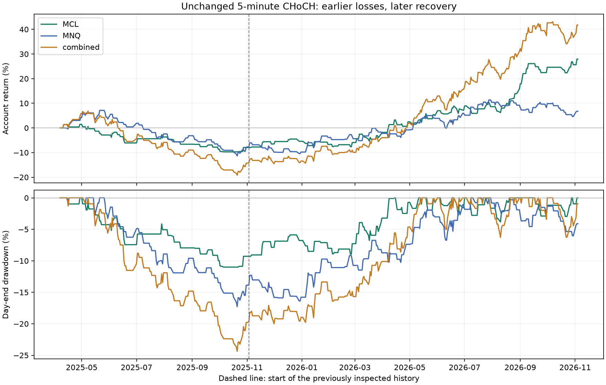

# Five-minute CHoCH: additional-history validation

**The added earlier period weakens the previous profitability assessment. At $50,000, MCL returned -7.96%, MNQ -7.77%, and the combined account -14.32%. Positive extended-period returns do not remove that losing regime.**

This study keeps the existing **five-minute confirmed-retest / 2R** rules fixed and tests MCL, MNQ and a shared account trading both. It adds **7 April-31 October 2025**, before the previously studied year, and also replays the uninterrupted extended history through **4 November 2026**. Dates are CME trading dates, with the end exclusive at 5 November 2026. No new filter, stop, target, session or market ranking is fitted.

**This is retrospective reverse-time validation.** The markets were chosen using later results, and the four-hour study examined overlapping history. It is additional evidence, not an untouched forward holdout. The two OHLC paths are assumptions, not observed tick paths or confidence bounds.

## New earlier-period result

Fresh $50,000 accounts; 1% maximum planned risk per entry, whole contracts, fees/slippage, capital reservations and shared-account risk limits. Rows show lower return, trade count, PF and net R, and higher drawdown across the two minute-price paths.

| Enabled markets | Trades | Win rate | Return | Mean daily return | Trades/day | Minute-mark DD | PF | Net R | Higher-cost resimulation return |
|---|---:|---:|---:|---:|---:|---:|---:|---:|---:|
| MCL | 35 | 31.43% | -7.96% | -0.054% | 0.23 | 11.61% | 0.59 | -8.68 | -10.01% |
| MNQ | 70 | 31.43% | -7.77% | -0.052% | 0.47 | 17.43% | 0.78 | -11.48 | -9.31% |
| combined | 105 | 31.43% | -14.32% | -0.100% | 0.70 | 25.19% | 0.73 | -20.16 | -17.65% |

MCL profitable in both paths on the added earlier history: **no**; MCL profitable in both full higher-cost resimulations: **no**. MNQ profitable in both paths on the added earlier history: **no**. These observations do not establish a persistent future edge.

The combined basket can have two positions and more deployed risk than either single-market account. It is an allocation experiment, not a comparison at matched realized volatility or identical average exposure.

## Uninterrupted extended history

Each row starts with $50,000 on 7 April 2025 and compounds through 4 November 2026. This is a fresh full replay, not the sum of separately funded period returns.

| Enabled markets | Trades | Period return | Mean daily return | Trades/day | Minute-mark DD | PF | P&L minus five largest winning trades |
|---|---:|---:|---:|---:|---:|---:|---:|
| MCL | 133 | +27.93% | +0.062% | 0.32 | 11.61% | 1.47 | $8,390.50 |
| MNQ | 201 | +6.77% | +0.019% | 0.49 | 17.43% | 1.07 | $-1,518.50 |
| combined | 334 | +41.75% | +0.090% | 0.81 | 25.19% | 1.27 | $14,365.90 |

Removing the five best trade profits is a concentration diagnostic at the recorded quantities; it does not resimulate later account sizing, risk halts or returns. Extended-period results include the previously inspected discovery period and therefore are not independent validation.

Chart uses day-end marks and the high-first path. The table reports the larger minute-mark drawdown, which can exceed the plotted daily drawdown.

## Smaller accounts on the earlier period

| Enabled markets | Starting equity | Trades | Return | Minute-mark DD | Capital/risk rejections |
|---|---:|---:|---:|---:|---:|
| MCL | $1,000 | 0 | +0.00% | 0.00% | 35 |
| MNQ | $1,000 | 0 | +0.00% | 0.00% | 73 |
| combined | $1,000 | 0 | +0.00% | 0.00% | 108 |
| MCL | $10,000 | 33 | -5.07% | 8.06% | 2 |
| MNQ | $10,000 | 30 | +1.04% | 5.02% | 43 |
| combined | $10,000 | 63 | -4.36% | 11.68% | 45 |
| MCL | $50,000 | 35 | -7.96% | 11.61% | 0 |
| MNQ | $50,000 | 70 | -7.77% | 17.43% | 3 |
| combined | $50,000 | 105 | -14.32% | 25.19% | 3 |

The inherited static full-initial-margin proxies are $884.53 per MCL and $4,647.32 per MNQ, with at most 80% of account equity allocated on entry. **A $1,000 account cannot open either contract under these assumptions.** Its 0% result reflects no trades, not a safe profitable strategy. These are the previous study’s planning values, not current broker quotations or reconstructed 2025 margin requirements. The simulator excludes platform/data subscriptions, taxes, withdrawals, slippage beyond its assumptions and broker-specific buying power.

## Monthly extended-account returns

Monthly returns compound daily account marks. Values below use the high-first path; all low-first daily marks and journals are also retained.

| Month | MCL | MNQ | Combined |
|---|---:|---:|---:|
| 2025-04 | +1.45% | +4.24% | +5.80% |
| 2025-05 | -4.26% | -0.60% | -4.67% |
| 2025-06 | -3.32% | -2.02% | -5.46% |
| 2025-07 | +2.57% | -3.90% | -1.28% |
| 2025-08 | -3.04% | -0.75% | -3.31% |
| 2025-09 | -2.20% | -4.30% | -6.40% |
| 2025-10 | +0.77% | -0.49% | +0.58% |
| 2025-11 | +1.56% | -0.38% | +1.40% |
| 2025-12 | +1.18% | -1.81% | -0.36% |
| 2026-01 | -1.33% | +6.56% | +5.20% |
| 2026-02 | +0.80% | -0.53% | -1.08% |
| 2026-03 | +4.39% | +2.24% | +6.60% |
| 2026-04 | +4.36% | +1.48% | +6.10% |
| 2026-05 | +2.46% | +4.71% | +8.93% |
| 2026-06 | +2.09% | +2.00% | +4.20% |
| 2026-07 | +1.34% | +4.21% | +7.67% |
| 2026-08 | +6.64% | -1.08% | +5.27% |
| 2026-09 | +5.71% | -0.89% | +4.85% |
| 2026-10 | +2.60% | -3.35% | -0.53% |
| 2026-11 | +1.83% | +2.05% | +3.68% |

## Session and direction diagnostics

Descriptive breakdown of the uninterrupted $50,000 single-market high-first replays. This breakdown was added after seeing the main period results; it is not a tested filter or a selection rule. Net R uses each trade’s actual planned risk including modeled stop slippage and round-trip fees.

| Market | Entry period | Session | Side | Trades | Wins | Net R |
|---|---|---|---|---:|---:|---:|
| MCL | added earlier | asia | long | 1 | 0 | -1.00 |
| MCL | added earlier | asia | short | 1 | 0 | -1.00 |
| MCL | added earlier | new_york | long | 14 | 6 | +1.34 |
| MCL | added earlier | new_york | short | 19 | 5 | -8.02 |
| MCL | previously inspected | asia | long | 21 | 10 | +7.82 |
| MCL | previously inspected | asia | short | 12 | 9 | +13.49 |
| MCL | previously inspected | new_york | long | 37 | 25 | +20.12 |
| MCL | previously inspected | new_york | short | 28 | 8 | -5.14 |
| MNQ | added earlier | asia | long | 17 | 7 | +3.48 |
| MNQ | added earlier | asia | short | 15 | 4 | -3.26 |
| MNQ | added earlier | new_york | long | 21 | 6 | -7.91 |
| MNQ | added earlier | new_york | short | 17 | 5 | -3.78 |
| MNQ | previously inspected | asia | long | 26 | 10 | +3.50 |
| MNQ | previously inspected | asia | short | 32 | 14 | +8.87 |
| MNQ | previously inspected | new_york | long | 31 | 12 | +0.50 |
| MNQ | previously inspected | new_york | short | 42 | 21 | +8.41 |

## Cost and execution assumptions

Base: $0.85 commission per contract per side and one adverse tick on market fills. The six earlier $50,000 stress cases **fully rerun** at $1.50 per side and two adverse ticks, including new entry prices, targets, sizes, fills and risk halts. This differs from the prior report’s fixed-fill repricing, which is retained separately in each baseline result for reference. Neither is an actual broker fee quote or measured order-book slippage.

Risk and capital limits remain: 1% maximum planned equity risk per entry, 2% total planned open risk, two simultaneous positions, one equity-index future, a 3% daily-loss budget and at most 80% capital utilization. Entry risk includes modeled stop slippage and round-trip fees. Gaps can exceed planned losses. Five-minute rules remain two-left/two-right confirmed pivots, structural stop, retest confirmation within three candles, immediate next-minute execution, first eligible setup per NY/Asia session, two trades per asset per CME day, original missing-bucket resets and daily flattening.

## Reproduction and data audit

**34 cases / 2,698 simulated trade records / 335 distinct entry opens** audited. Overlapping paths, capitals and periods are not independent trade samples. Audit checks raw entry prices, commissions, 2R brackets, causal pivot/retest times, whole-contract sizing, shared risk/capital ceilings, per-session/day limits and daily/final equity reconciliation. Both saved MCL controls reproduce every trade and daily equity exactly; both MNQ controls match fresh original-engine replays.

All raw data use actual dated MCL/MNQ contracts, not standard-contract proxies. MCL expiration dates and tick sizes come from [Massive historical contract references](https://massive.com/docs/rest/futures/contracts). Calendar rolls retain the original study’s convention, not a hindsight volume choice. [CME describes MCL as a 100-barrel contract](https://www.cmegroup.com/markets/energy/crude-oil/micro-wti-crude-oil.contractSpecs.html). Raw minute data, calendars and source/input hashes are preserved locally. Missing bars are not fabricated; conflicting duplicate minutes are quarantined. The inherited calendar parser and reset convention are preserved for comparability, including their limitations around holidays and missing sessions. Tagged stale old-contract marks, if present, are unverified exit assumptions.

| Case group | Maximum tagged roll marks | Largest return difference between paths |
|---|---:|---:|
| earlier | 0 | 0.0000 percentage points |
| extended | 1 | 0.0000 percentage points |
| control | 1 | 0.0000 percentage points |

The extended MNQ and combined replays each contain one MNQ exit booked on 13 September 2026 using the last available old-contract mark from 11 September. The recorded net P&L on that trade is -$180.70 for the standalone MNQ account and -$361.40 for the combined account. These are tagged research assumptions, not verified market exits; the extended totals inherit this uncertainty. **The added earlier-period cases and all MCL-only cases have no tagged roll exits.**

A profitable earlier-period result increases the case for paper testing unchanged rules. A poor result calls for revising the evidence assessment before searching for a new filter. Neither outcome authorizes live trading or a claim of dependable daily income. No existing paper configuration was changed.

Reproduce: `python -m research.five_minute_download`, `python -m research.five_minute_validation --workers 3`, `python -m research.five_minute_validation_report`. All 34 cases, including small accounts, losing results and stress cases, are saved in `research/results/five_minute_validation/`. The frozen design is `research/five_minute_validation_protocol.json`.
