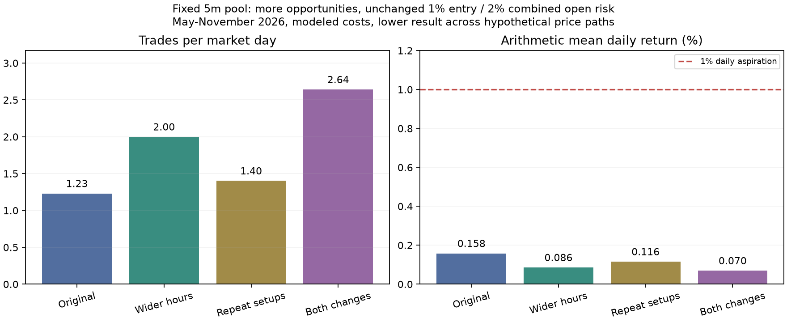

# More daily trades: controlled CHoCH frequency test

Fixed basket: **JPM, MCL, MYM, SLV, AMZN**, selected before May using the earlier training period. Test **1 May-4 November 2026**, fresh **$50,000**, 5m confirmed-retest entries and 2R targets. This is a retrospective extension of inspected dates, not new untouched validation.

## All four declared variants

| Variant | Trades | Trades / market day | Mean daily return | Period return | Maximum minute-mark DD | PF | Fixed-fill stress P&L |
|---|---:|---:|---:|---:|---:|---:|---:|
| Original | 165 | 1.23 | +0.158% | +22.68% | 7.42% | 1.38 | $8,833.81 |
| Wider hours | 268 | 2.00 | +0.086% | +10.98% | 10.37% | 1.11 | $1,301.30 |
| Repeated distinct setups | 188 | 1.40 | +0.116% | +15.88% | 8.65% | 1.24 | $5,224.97 |
| Both changes | 354 | 2.64 | +0.070% | +8.27% | 16.31% | 1.08 | $-635.29 |

Variants reaching at least 1% arithmetic mean daily return under both assumed paths: **none**. Daily denominators include zero-trade market dates. Rows report lower trades/returns/PF/stress and higher drawdown across paths, not confidence bounds. Minute-mark drawdown can miss intraminute extremes.

## What changed, and what the comparison means

Wider hours extend stock/ETF entries to NY 09:30-15:30, futures to NY 09:30-15:30 and 18:30-23:30. Original liquidation calendars and five-minutes-before-close exits remain. Repeated-setups mode releases the one-signal-per-session reservation and raises each asset's daily cap from two to six, while still requiring a new, unconsumed CHoCH pivot and valid retest. A held position still prevents another entry in that asset. No recycling losing setups or adding to positions.

Risk is unchanged: up to **1% planned account risk per entry, 2% aggregate open risk, two concurrent positions, one equity-index future, 3% daily opening-equity loss budget**, per-asset two-consecutive-loss halt, full initial-futures-margin planning reserves and gross stock notional reserves. Gaps can exceed planned risk. All four cases and both paths were frozen before their results; no additional rule search was used to force a daily target.

These tests alter opportunity frequency, not the signal timeframe, structural stop, target, market membership or position-risk percentage. More fills are useful only if their net expectancy and capital efficiency are positive after execution costs. Previous 1m-3m breadth tests already increased trade counts while most asset cells lost money; faster candles are not evidence of a stronger edge.

## Daily-target arithmetic, not a forecast

The original basket's mean net trade return was **0.1285% of its entry account equity**. If that exact edge and sizing could be retained on every extra opportunity, rough arithmetic would require **8 trades/day for 1%**, **16 for 2%**, **39 for 5%**, or **71 for 9%**. This linear illustration ignores changing equity within the day, correlations, risk halts and selection degradation. It is not a projection, an achievable setup count or an execution plan.

A constant compounded 1% every market day would multiply capital about **12.3 times in 252 days**. A variable arithmetic mean of 1% does not guarantee that compound growth. The user's 1%-9% aspiration is not supported merely by increasing turnover, and this experiment does not promise such returns or change risk to manufacture them.

## Costs and practical limits

Base costs remain futures $0.85/side and one adverse market tick; stock/ETF $0.005/share/fill and one adverse cent. Stress reprices the same fills and quantities with the pre-existing higher commissions and extra adverse tick; it does not resimulate sizing or compound returns under stressed costs. Borrow fees, margin interest, fixed subscriptions, actual margin schedules and broker buying power are not reconstructed. A gross-notional allocation reserve is **not a settled-cash ledger**: repeated stock trading needs the appropriate account/settlement arrangements. [FINRA's frequent intraday trading guidance](https://syndication.finra.org/content/frequent-intraday-trading-understanding-basics).

The account is one virtual USD pool; actual cross-broker transfers and account restrictions can reduce feasible frequency. These are hypothetical OHLC execution paths, not tick fills. Tagged stale-mark research liquidations remain unverified executable exits. The results do not certify live trading feasibility.

## Reproduction and audit

Run `python -m research.frequency_study --workers 3`, then `python -m research.frequency_report`. [Protocol](research/frequency_protocol.json), [summary](research/results/frequency_summary.json) and [all eight journals](research/results/frequency) retain configurations, trades, daily equity, allocations and source/input hashes. Raw prices remain local and ignored. No default strategy or broker orders changed.

**136 tests passed**, including unchanged-risk checks and ensuring session repetition never clears consumed-pivot protection. 1,950 simulated executions passed fee/ledger, timing, entry-risk, daily-return and input/source checks. Both baseline paths matched the previous pool's full trade lists and daily marks exactly. These checks substantiate simulation mechanics, not predictive profitability.
