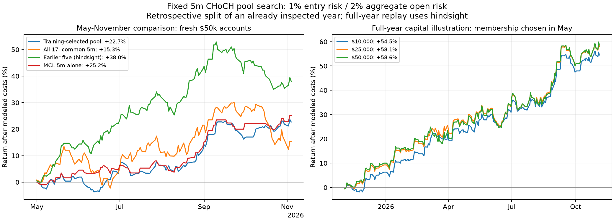

# CHoCH pool search: early selection, later comparison

Expanded candidate universe: **29 instruments**, adding **SPY, QQQ, IWM, GLD, SLV, USO, XLE, XLF, META, AMD, CVX, COP** to the original 17. All candidates use the same **5m confirmed-retest CHoCH / 2R** rules. No new entry filter, target, session or leverage search was performed.

The fixed training-only rule selected **JPM, MCL, MYM, SLV, AMZN**. Membership uses only trades entered and completed from **3 November 2025 through 30 April 2026**. Its later comparison covers **1 May through 4 November 2026** on fresh accounts, with earlier bars retained for causal indicator warmup.

**The year was already inspected.** This chronological split avoids using later trade outcomes directly in membership scores, but it is not pristine out-of-sample validation. The earlier five-market comparator was selected from the full year and has an explicit hindsight advantage. The exposure buckets are rough allocation constraints, not proof of independent market returns.

## Later-period shared-account comparison

| Pool | Initial equity | Trades | Trades / market day | Mean daily return | Period return | Maximum minute-mark DD | PF | Fixed-fill stress P&L |
|---|---:|---:|---:|---:|---:|---:|---:|---:|
| All 17, 5m | $50,000 | 405 | 3.02 | +0.119% | +15.26% | 15.76% | 1.09 | $449.23 |
| Earlier screened five (hindsight) | $50,000 | 217 | 1.62 | +0.248% | +38.04% | 14.43% | 1.36 | $16,148.65 |
| MCL 5m alone | $50,000 | 59 | 0.44 | +0.171% | +25.18% | 4.90% | 2.02 | $11,277.00 |
| Training-selected pool | $50,000 | 165 | 1.23 | +0.158% | +22.68% | 7.42% | 1.38 | $8,833.81 |

Each row uses the lower trade count/return/PF/stress P&L and higher drawdown across both assumed minute paths. All accounts use the same dates, fresh $50k capital and common observed MNQ futures-date clock, including zero-trade days. Arithmetic daily return averages each day's P&L divided by the prior closing equity. Drawdown uses minute marks and can miss intraminute extremes. Hypothetical price paths are not observed ticks or guaranteed bounds.

The selected-minus-all-17 difference in mean daily returns is **+0.039 percentage points**. A conditional five-day paired block-resampling interval is **-0.230 to +0.316 percentage points**. This is a descriptive interval conditional on this year and fixed membership; it is not adjusted for the selection history and is not a significance or future-profit claim.

## Current paper-watchlist application, as of 5 November 2026

After the comparison, apply the **same unchanged thresholds, score and exposure constraints** to trades completed **1 May through 4 November 2026**, using May-Jun, Jul-Aug and Sep-through-4-Nov blocks. This post-study roll-forward produces **MCL, MNQ, COP, MGC, NVDA**, all 5m. [Current watchlist](research/results/pool_current_watchlist.json) retains every recent score and rejection.

**These are different memberships.** The later-period return reported above belongs to the pool selected before May, not this November watchlist. No subsequent period exists in these data to validate the exact current basket. Its recent winners may reverse; it is a paper-research candidate, with no future return forecast, broker orders, or default live/paper setting changed. This application does not alter the primary historical selection or try a second rule to improve its backtest.

## Capital illustrations: full-year hindsight replay

These accounts apply the pool chosen on 1 May **back to November 2025**. They illustrate capital/sizing sensitivity, **not a historically implementable selection available at the start of the year**. The later-period comparison above is the primary diagnostic.

| Pool | Initial equity | Trades | Trades / market day | Mean daily return | Period return | Maximum minute-mark DD | PF | Fixed-fill stress P&L |
|---|---:|---:|---:|---:|---:|---:|---:|---:|
| Selected pool: full-year hindsight replay | $10,000 | 272 | 1.04 | +0.171% | +54.51% | 6.16% | 1.57 | $4,600.21 |
| Selected pool: full-year hindsight replay | $25,000 | 297 | 1.14 | +0.180% | +58.08% | 7.04% | 1.49 | $12,026.56 |
| Selected pool: full-year hindsight replay | $50,000 | 297 | 1.14 | +0.182% | +58.64% | 7.37% | 1.46 | $24,103.94 |

## Frozen selection rule and all candidate results

Require both price paths to have at least **20 completed early trades**, PF >= **1.20**, positive base net P&L in at least **two of three two-month training blocks**, and positive P&L under the pre-existing breadth cost stress. Exclude `roll_data_end_mark` and `end_of_data` liquidations from training selection. Score is the lower path's mean stressed net R multiplied by square root of early trade count. Select at most five eligible markets, at most one per declared exposure bucket, with alphabetical ties. No second rule was tried after these results.

The rule can pick fewer than five markets or remain in cash. Its minimum sample and score are research choices, not proof that these small training samples identify true alpha. Only early outcomes enter the score; tests verify that changing later profits cannot alter membership statistics.

| Asset | Status | Min early trades | Lower early PF | Lower early stress P&L | Positive blocks | Score | Failed tests / bucket |
|---|---|---:|---:|---:|---:|---:|---|
| XOM | fails | 15 | 6.06 | $3,509.09 | 3/3 | 2.287 | insufficient_training_trades |
| JPM | SELECTED | 22 | 3.34 | $3,639.66 | 2/3 | 1.973 | financials |
| SIL | fails | 11 | 2.17 | $2,449.00 | 2/3 | 1.964 | insufficient_training_trades |
| MCL | SELECTED | 39 | 1.70 | $4,757.00 | 2/3 | 1.636 | oil |
| MYM | SELECTED | 34 | 1.65 | $3,720.00 | 3/3 | 1.348 | equity_index |
| MES | eligible, outside pool | 51 | 1.48 | $4,549.25 | 2/3 | 1.331 | equity_index |
| MNQ | eligible, outside pool | 55 | 1.47 | $5,107.00 | 2/3 | 1.149 | equity_index |
| SPY | eligible, outside pool | 23 | 1.74 | $1,118.12 | 3/3 | 0.651 | equity_index |
| SLV | SELECTED | 26 | 1.39 | $1,433.01 | 2/3 | 0.561 | silver |
| AMZN | SELECTED | 25 | 1.39 | $1,325.17 | 2/3 | 0.325 | consumer |
| UNH | eligible, outside pool | 33 | 1.31 | $1,466.62 | 3/3 | 0.259 | healthcare |
| XLF | fails | 15 | 1.93 | $596.90 | 3/3 | 0.004 | insufficient_training_trades |
| TSLA | fails | 26 | 1.13 | $628.79 | 2/3 | -0.108 | training_profit_factor |
| MSFT | fails | 22 | 0.65 | $-1,139.37 | 2/3 | -0.113 | training_cost_stress, training_profit_factor |
| CVX | fails | 25 | 0.68 | $-1,550.83 | 2/3 | -0.212 | training_cost_stress, training_profit_factor |
| IWM | fails | 22 | 1.17 | $352.52 | 1/3 | -0.308 | training_profit_factor, training_time_blocks |
| USO | fails | 10 | 0.91 | $-344.12 | 1/3 | -0.439 | insufficient_training_trades, training_cost_stress, training_profit_factor, training_time_blocks |
| AAPL | fails | 22 | 0.77 | $-994.06 | 1/3 | -0.483 | training_cost_stress, training_profit_factor, training_time_blocks |
| NVDA | fails | 24 | 0.88 | $-665.97 | 2/3 | -0.638 | training_cost_stress, training_profit_factor |
| XLE | fails | 24 | 0.75 | $-1,742.22 | 0/3 | -0.964 | training_cost_stress, training_profit_factor, training_time_blocks |
| GLD | fails | 21 | 0.41 | $-2,052.38 | 0/3 | -1.112 | training_cost_stress, training_profit_factor, training_time_blocks |
| M6E | fails | 13 | 0.45 | $-2,591.25 | 0/3 | -1.499 | insufficient_training_trades, training_cost_stress, training_profit_factor, training_time_blocks |
| QQQ | fails | 21 | 0.51 | $-1,475.32 | 1/3 | -1.701 | training_cost_stress, training_profit_factor, training_time_blocks |
| META | fails | 16 | 0.27 | $-2,899.61 | 0/3 | -1.789 | insufficient_training_trades, training_cost_stress, training_profit_factor, training_time_blocks |
| COP | fails | 25 | 0.29 | $-3,784.67 | 0/3 | -2.000 | training_cost_stress, training_profit_factor, training_time_blocks |
| AMD | fails | 23 | 0.33 | $-4,886.15 | 0/3 | -2.285 | training_cost_stress, training_profit_factor, training_time_blocks |
| MGC | fails | 57 | 0.52 | $-7,544.00 | 0/3 | -2.568 | training_cost_stress, training_profit_factor, training_time_blocks |
| BTCUSD | fails | 39 | 0.77 | $-5,652.47 | 0/3 | -2.658 | training_cost_stress, training_profit_factor, training_time_blocks |
| M2K | fails | 41 | 0.43 | $-7,841.50 | 0/3 | -2.829 | training_cost_stress, training_profit_factor, training_time_blocks |

## Full-year candidate diagnostics: discovery only

For transparency, the original breadth study's full-year screen is also applied to every candidate: both paths must have at least 30 trades, PF >=1.20, positive net and stressed P&L, and at least three of four positive time blocks. This view uses the later outcomes and **does not enter the training-only pool membership**. New instruments passing this descriptive full-year screen: **SLV**. A full-year passing name is a research candidate, not independently validated alpha.

| Asset | Full-year screen | Min trades | Lower return | Lower PF | Higher intrabar-model DD | Positive blocks |
|---|---|---:|---:|---:|---:|---:|
| XOM | passes | 38 | +7.50% | 2.12 | 3.69% | 3/4 |
| JPM | fails | 52 | +4.24% | 1.36 | 6.73% | 1/4 |
| SIL | passes | 51 | +11.16% | 1.48 | 7.95% | 3/4 |
| MCL | passes | 98 | +40.15% | 1.92 | 4.95% | 4/4 |
| MYM | fails | 85 | +1.17% | 1.03 | 8.53% | 2/4 |
| MES | fails | 118 | +9.51% | 1.15 | 8.26% | 3/4 |
| MNQ | passes | 132 | +23.90% | 1.38 | 6.68% | 3/4 |
| SPY (added) | fails | 48 | +0.33% | 1.04 | 4.11% | 3/4 |
| SLV (added) | passes | 47 | +6.30% | 1.41 | 3.80% | 4/4 |
| AMZN | fails | 45 | +1.33% | 1.09 | 4.02% | 2/4 |
| UNH | fails | 55 | +2.36% | 1.13 | 3.81% | 2/4 |
| XLF (added) | fails | 45 | +1.51% | 1.18 | 3.22% | 2/4 |
| TSLA | fails | 51 | -0.19% | 0.99 | 6.03% | 2/4 |
| MSFT | fails | 52 | -5.51% | 0.67 | 7.25% | 1/4 |
| CVX (added) | fails | 48 | -0.97% | 0.93 | 6.02% | 2/4 |
| IWM (added) | fails | 46 | -2.97% | 0.77 | 6.29% | 2/4 |
| USO (added) | fails | 31 | +5.57% | 1.47 | 4.62% | 2/4 |
| AAPL | fails | 44 | -1.15% | 0.92 | 3.88% | 2/4 |
| NVDA | fails | 47 | +2.38% | 1.14 | 5.18% | 2/4 |
| XLE (added) | fails | 45 | -4.71% | 0.69 | 6.17% | 0/4 |
| GLD (added) | fails | 49 | -1.12% | 0.90 | 5.57% | 2/4 |
| M6E | insufficient | 18 | -4.31% | 0.53 | 6.51% | 1/4 |
| QQQ (added) | fails | 50 | -0.48% | 0.96 | 3.62% | 1/4 |
| META (added) | fails | 34 | -4.60% | 0.63 | 8.37% | 1/4 |
| COP (added) | fails | 51 | -1.62% | 0.90 | 8.37% | 2/4 |
| AMD (added) | fails | 38 | -7.61% | 0.61 | 10.64% | 1/4 |
| MGC | fails | 123 | -8.70% | 0.84 | 16.29% | 2/4 |
| BTCUSD | fails | 76 | -10.44% | 0.68 | 13.41% | 0/4 |
| M2K | fails | 76 | -18.70% | 0.53 | 21.16% | 1/4 |

## Allocation, costs and practical limits

Shared allocation is unchanged: up to **1% planned equity risk per entry, 2% combined planned open risk, two concurrent positions, one equity-index future**, a 3% daily opening-equity loss budget, full initial-futures-margin planning reserves, 100% gross stock/BTC notional reserves, and an 80% pre-entry capital-utilization limit. Same-minute entries are allocated alphabetically before any later minute extremes can finance another entry. Stock/ETF entries are NY 09:30-12:00 and flatten five minutes before the regular/early close; original futures windows and liquidation rules remain.

ETFs use the stock engine, whole shares, the same cent normalization, assumed $0.005/share/fill and one-cent market slippage. Futures remain $0.85/side and one adverse tick; BTC remains long-only spot with 0.10%/fill and one basis point market slippage. Stock/ETF shorts assume borrow availability; borrow fees, margin interest, fixed subscriptions and taxes are unmodeled. Split-adjusted prices and daily-flat positions do not reconstruct a full corporate-action ledger. This is a selected surviving instrument sample, not a historical universe.

Stress reprices the same fills and quantities using futures $1.50/side, stock/ETF $0.01/share/fill, BTC 0.20%/fill, plus one extra adverse tick on entry and market exits (one basis point for BTC). It does not replay stressed sizing, compounding or allocation, and is not a stressed compound-return forecast.

Margin reserves inherit the [NinjaTrader table](https://ninjatrader.com/pricing/margins/) dated 31 August 2026 and are a static planning proxy across the year, not historical broker margin. Actual cross-broker buying power and account restrictions are not reconstructed. Roll-gap exits retain explicitly tagged unverified last-mark research liquidations, booked only when observed in the portfolio. Previous reports' assumptions remain applicable.

## Reproduction and checks

Run `python -m research.pool_download`, then `python -m research.run_pool --workers 3`, then `python -m research.pool_report`. [Protocol](research/pool_protocol.json), [training selection](research/results/pool_selection.json), [summary](research/results/pool_summary.json), [candidate journals](research/results/pool_candidates) and [portfolio journals](research/results/pool_portfolios) retain every outcome and source/input fingerprints. Raw data/API caches remain ignored locally. Unavailable instruments: **none**.

**126 tests passed.** Audited 58 candidate cases, 14 shared-account cases and 6,810 simulated trade executions. Checks cover pivot availability, entry risk, fees, cash notional, ledger reconciliation, daily compounding, source/input hashes and reproducing every training score/selection. All 34 original 5m candidate journals matched exactly; the later MCL control matched 59 original signal-price/timing records, with sizes appropriately recalculated for fresh capital.

Repeated strategy/market selection can inflate apparent backtest performance; a chronological slice of an already inspected dataset does not erase this history. [Bailey et al., The Probability of Backtest Overfitting](https://www.davidhbailey.com/dhbpapers/backtest-prob.pdf).
