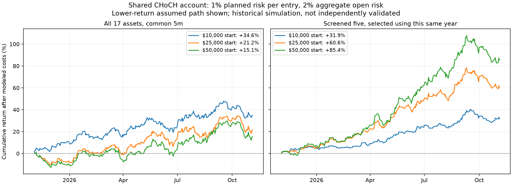

# CHoCH shared-account portfolio: capital, frequency and daily returns

Period: **3 November 2025 through 4 November 2026**. This replays raw minute bars with one shared, compounded USD equity ledger. It does not add returns from the separate $50,000 asset studies or resize their completed trade lists. Every one of the **12 declared cases** is retained: two baskets, $10k/$25k/$50k and two assumed minute-price paths.

The first basket trades **all 17 evaluated assets on 5m structure**. The second uses MNQ 5m, MGC 10m, MCL 5m, SIL 5m and XOM 5m. **The second basket is selected using the same year's already inspected results. Its apparent advantage is retrospective and cannot validate selecting those markets for future trading.** It uses the same CHoCH logic, with a different timeframe for MGC.

**A common framework is useful, but indiscriminately enabling every market is not supported by a strong result here.** At $50,000 the broad basket returned +15.12% with a profit factor of 1.05 and 15.76% maximum minute-mark drawdown. Repricing its fills with the breadth study's pre-existing higher-cost assumptions produces **$-5,299.74 net P&L**. That is a thin historical edge vulnerable to execution costs. The screened basket remains a hindsight-selected comparison.

## Results after modeled commissions and slippage

| Basket | Starting equity | Trades | Trades / market day | Arithmetic mean daily return | Geometric daily equivalent | Total period return | Maximum minute-mark DD | Mean daily P&L |
|---|---:|---:|---:|---:|---:|---:|---:|---:|
| all_17_same_5m | $10,000 | 592 | 2.27 | 0.121% | 0.114% | 34.64% | 12.56% | $13.27 |
| all_17_same_5m | $25,000 | 691 | 2.65 | 0.083% | 0.074% | 21.24% | 13.81% | $20.34 |
| all_17_same_5m | $50,000 | 728 | 2.79 | 0.065% | 0.054% | 15.12% | 15.76% | $28.97 |
| screened_five_retrospective | $10,000 | 149 | 0.57 | 0.108% | 0.106% | 31.89% | 9.21% | $12.22 |
| screened_five_retrospective | $25,000 | 292 | 1.12 | 0.187% | 0.182% | 60.58% | 12.86% | $58.02 |
| screened_five_retrospective | $50,000 | 367 | 1.41 | 0.244% | 0.237% | 85.36% | 14.52% | $163.52 |

Each row combines both hypothetical OHLC paths; ranges are model sensitivity, not confidence intervals or guaranteed bounds. Daily denominators include zero-trade dates with observed futures data in the included basket. Each basket has 261 such dates. Arithmetic mean daily return is the mean of **daily P&L divided by the previous day's closing account equity**, with initial equity for the first day. The geometric daily equivalent compounds to the total return; total return divided by the number of days is neither of these measures. Mean daily dollars also include zero-trade days. None is a daily income promise.

Drawdown here uses common minute open/close account marks, so it can miss intraminute extremes and should not be compared directly to tick-level drawdown or the standalone engines' intrabar drawdowns. Intraminute OHLC paths remain hypothetical.

The summary also applies the breadth study's existing cost stress to each fixed portfolio fill and quantity: futures $1.50/side, stocks $0.01/share/fill, BTC 0.20%/fill, plus one additional adverse tick on entry and market exits (one basis point for BTC). This is postprocessing with an existing stress specification, not a new optimized screen. It **does not resimulate signals, compounding or capital allocations**, so normalized stressed P&L is not a stressed compound-return forecast.

## Allocation and capital assumptions

- Same confirmed 2-left/2-right pivots, counter-trend closing break, confirmed retest within three candles, next-minute open entry, structural stop and 2R target. Original instrument calendars, sessions, costs, long-only BTC, hypothetical stock shorts and at most two entries per asset/day are retained.
- Up to **1% shared equity planned risk per entry**, **2% aggregate planned open risk**, **two concurrent positions**, and **one equity-index future** at a time. A 3% daily opening-equity loss budget further limits sizing; a breached daily limit halts entries and exits at the next observed open. Gaps and delayed observations can exceed planned limits.
- All symbols are marked at their minute opens; existing opening-price exits are processed before new entries. Same-minute candidates are allocated alphabetically, before any symbol's high/low is traversed. Profits later in a minute cannot fund an earlier entry in another asset. Skipped orders are consumed; no ranking by future performance is used.
- Reserve **full initial futures margin**, using the [NinjaTrader table](https://ninjatrader.com/pricing/margins/) dated **31 August 2026**, retrieved **5 November 2026**: MNQ $4,647.32, MES $2,863.17, MGC $2,472.80, MYM $1,698.87, M2K $1,225.69, MCL $884.53, M6E $231 and SIL $7,370 per contract. This is a **static capital-planning proxy throughout the year**, not reconstructed historical margin. No cross-contract margin offsets are assumed. The broker may change these requirements; [margin policy](https://ninjatrader.com/pricing/margins-position-management/).
- Reserve 100% gross notional for stocks (including hypothetical shorts) and spot BTC. New allocations use at most 80% of pre-entry equity after accounting for existing reserves and entry fees; marks and transaction costs can subsequently change that percentage. Whole quantities and available risk/capital determine which trades are affordable. More capital does not change the percentage risk budget; it improves sizing granularity and access to high-margin contracts.
- Stock borrow, borrow fees, actual stock buying power, margin interest, taxes and fixed platform/data fees are unmodeled. One virtual USD pool does not prove that funds can be reused instantly across stock, futures and crypto brokers. Actual broker/account jurisdiction restrictions can increase capital needs. These are simulated equity levels, not universal broker minimums or certified account suitability.
- Roll gaps use the last old-contract mark plus slippage, tagged and **booked only when the new contract is observed**. They are not backdated into the portfolio and are not verified executable exit prices. Positions without fresh prices retain stale marks until an observed exit opportunity.

## How to interpret this

A common signal engine plus shared risk and capital controls is a useful architecture. The broader universe is a test of that architecture, not proof every asset deserves an allocation. Compare the all-17 basket with the screened illustration, while remembering the latter was chosen using hindsight. This study does not establish that either basket will retain its historical daily average, or that adding markets improves independent future performance.

The tested $10k/$25k/$50k levels are scenarios, not an optimized minimum. A smaller account may scan all markets while skipping unaffordable signals. Requiring every eligible signal to receive a full 1% allocation simultaneously would need different concurrency, margin and risk assumptions. Shared capital also requires a practical broker/account allocation before live deployment.

The $10k broad-universe case actually filled trades in **16 of the 17 markets**, including **0 SIL trades**. Scanning a market does not guarantee an affordable entry. $25k-$50k provides more sizing flexibility in these scenarios, while the modeled percentage return actually declines as capital admits a different set of trades. This is not evidence to optimize starting capital to $10k; the account-size sensitivity is another reason the result needs future validation.

## Verification and reproduction

Run `python -m research.run_portfolio --workers 3`, then `python -m research.portfolio_report` from the repository root, after acquiring the breadth-study data. [Policy](research/portfolio_protocol.json), [summary](research/results/portfolio_summary.json), and [compressed case journals](research/results/portfolio) retain assumptions, all outcomes, daily equity, every trade, entry allocations, rejection counts, roll marks and source/input hashes. Raw data and logs remain ignored locally.

5,638 simulated trade executions passed ledger/fee checks; all 12 outputs passed daily-return compounding, input/source-hash, entry-risk and position-count checks. A single-asset MCL control matched all 98 original trades exactly. **118 unit tests passed**, including shared equity, reserve constraints, correlation limits, daily halt timing and a regression proving a later same-minute stock high cannot finance an earlier futures entry. These checks validate stated mechanics, not the future profitability hypothesis.
