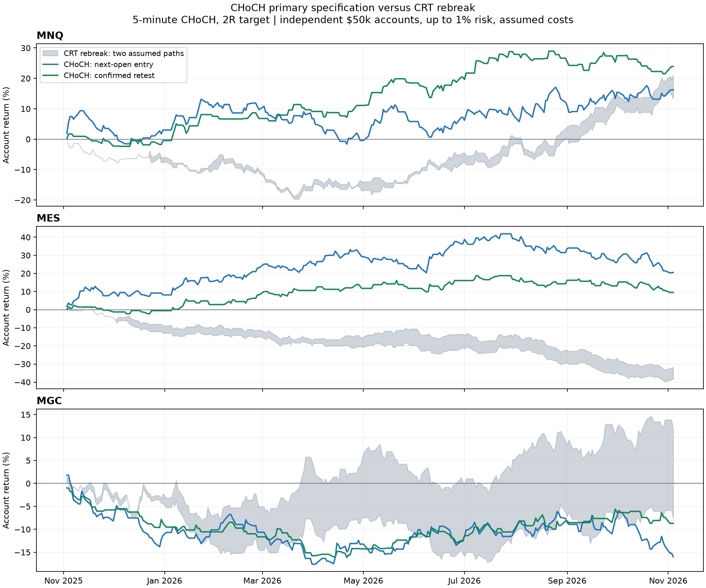

# CHoCH futures test: fixed rules, realistic signal timing

Evaluation: **3 November 2025 through 4 November 2026**, on the existing dated MNQ, MES and MGC minute cache. The primary specification is **5-minute structure, 2R target**, with immediate and confirmed-retest entries. Fifteen-minute structure and 1.5R are separately declared sensitivities; they do not replace the primary result after inspection. All 48 CHoCH cases and six matched CRT comparators are reported.

## What was tested

A change of character means a counter-trend break of swing structure. Definitions vary, so this tests our explicit mechanical interpretation, rather than a particular trader's discretionary method. The conceptual reference describes the counter-trend break, closing confirmation and possible retracement entry; our pivot width, trend test, sessions, stop, expiry and targets are research choices. [Concept source](https://www.luxalgo.com/library/concept/change-of-character/).

- A swing high/low must exceed/be below the two candles on either side, strictly. It becomes usable only after the second right-hand candle closes. Outside candles qualifying as both are ignored. The latest two confirmed highs and lows must both rise for an uptrend, or both fall for a downtrend.
- A bearish signal closes at least one tick below the latest swing low in an uptrend; bullish is the mirror. Require a crossing from the other side and consume that pivot once. Mixed structure has no trade. Structure resets at missing timeframe buckets and contract changes.
- Stop: one tick beyond the most adverse observed extreme since the latest opposite swing, frozen at break confirmation. Target: 2R primary (1.5R sensitivity), calculated from actual slipped entry to the frozen stop and rounded outward to a tick.
- Immediate: enter at the immediately following minute open. Retest: within three following complete structure candles, touch the broken level and close a tick back on the breakout side; then enter next minute open. A stop touch while waiting invalidates the setup; a data gap cancels the waiting setup, and a missing next entry minute cancels the order.
- First eligible signal reserves each session, including an unfilled/expired retest. Use the existing 09:30-12:00 and 20:00-22:00 New York entry sessions, two daily entries, one open position, and existing daily/exchange flattening. No discretion, FVG, order-block or economic-news overlay is included.

Waiting for pivot confirmation is essential: platforms can display a pivot at its earlier location after later candles establish it. Entries here cannot occur before that information exists. [Pivot timing documentation](https://www.tradingview.com/pine-script-docs/faq/techniques/).

## Results

**4 of 6 primary instrument/entry combinations were profitable under both price paths.** This count is descriptive, not an independent probability estimate. The table includes every sensitivity to avoid selecting only a profitable variant.

Independent $50,000 accounts, **up to 1% current-equity planned risk**, compounding, whole micro contracts and a 150-contract research cap. Planned risk includes modeled round-trip fees and adverse stop slippage. Costs are the original CRT assumptions: $0.85 per side/contract and one adverse tick at entry and stop/market exits. The fresh CRT rebreak comparator uses the same account limits, costs, calendar and paths; its original combined 15/30/60-minute signal rules remain.

| Instrument | Specification | Trades | Net win rate | Total return | Profit factor | Maximum marked drawdown |
|---|---|---:|---:|---:|---:|---:|
| MNQ | CRT rebreak | 211 to 212 | 47.64 to 49.29% | 13.39 to 21.15% | 1.14 to 1.22 | 18.87 to 20.30% |
| MNQ | 5m next_open, 2R | 268 | 40.30% | 16.23% | 1.12 | 13.68% |
| MNQ | 5m next_open, 1.5R | 270 | 45.56% | 17.76% | 1.14 | 15.11% |
| MNQ | 5m retest_close, 2R | 132 | 43.94% | 23.90% | 1.38 | 6.68% |
| MNQ | 5m retest_close, 1.5R | 132 | 48.48% | 20.65% | 1.36 | 6.11% |
| MNQ | 15m next_open, 2R | 67 | 49.25% | 0.63% | 1.03 | 4.29% |
| MNQ | 15m next_open, 1.5R | 68 | 51.47% | 3.73% | 1.19 | 4.15% |
| MNQ | 15m retest_close, 2R | 26 | 46.15% | 0.45% | 1.07 | 3.64% |
| MNQ | 15m retest_close, 1.5R | 26 | 46.15% | 0.16% | 1.02 | 3.64% |
| MES | CRT rebreak | 210 to 220 | 36.67 to 39.55% | -38.38 to -31.91% | 0.62 to 0.71 | 35.27 to 41.50% |
| MES | 5m next_open, 2R | 243 | 43.62% | 20.58% | 1.13 | 15.63% |
| MES | 5m next_open, 1.5R | 244 | 47.54% | 12.90% | 1.10 | 10.81% |
| MES | 5m retest_close, 2R | 118 | 43.22% | 9.51% | 1.15 | 8.26% |
| MES | 5m retest_close, 1.5R | 118 | 50.00% | 18.58% | 1.31 | 8.05% |
| MES | 15m next_open, 2R | 87 | 50.57% | 11.16% | 1.38 | 5.79% |
| MES | 15m next_open, 1.5R | 87 | 51.72% | 7.63% | 1.27 | 4.88% |
| MES | 15m retest_close, 2R | 40 | 55.00% | 1.98% | 1.18 | 3.14% |
| MES | 15m retest_close, 1.5R | 40 | 55.00% | 1.00% | 1.09 | 3.07% |
| MGC | CRT rebreak | 234 to 245 | 42.74 to 46.12% | -7.69 to 11.71% | 0.93 to 1.09 | 10.29 to 18.22% |
| MGC | 5m next_open, 2R | 253 | 36.36% | -15.99% | 0.86 | 19.38% |
| MGC | 5m next_open, 1.5R | 256 | 41.41% | -12.88% | 0.88 | 17.13% |
| MGC | 5m retest_close, 2R | 123 | 37.40% | -8.70% | 0.84 | 16.29% |
| MGC | 5m retest_close, 1.5R | 124 | 40.32% | -11.24% | 0.78 | 15.08% |
| MGC | 15m next_open, 2R | 47 | 42.55% | 0.16% | 1.01 | 5.04% |
| MGC | 15m next_open, 1.5R | 47 | 44.68% | -0.81% | 0.94 | 4.53% |
| MGC | 15m retest_close, 2R | 22 | 40.91% | -1.90% | 0.67 | 3.09% |
| MGC | 15m retest_close, 1.5R | 22 | 45.45% | -1.33% | 0.77 | 2.52% |

Ranges compare open-high-low-close and open-low-high-close minute paths. They are not actual ticks, confidence intervals or guaranteed profit bounds. Win rate counts net-positive trades after costs. Drawdown is peak-to-current equity percentage across processed path events, including unrealized P&L.

The chart uses daily last marks, with separate instrument accounts. The grey CRT band connects the two hypothetical paths; it is not a confidence band. The primary CHoCH curves coincide under both assumed paths in this dataset. Regenerate the figure with `python -m research.plot_structure_comparison` after producing the results JSON.

## Limits and audit trail

Review of the primary runs: MNQ confirmed-retest earned $11,949.10 net, split into $10,205.80 for entries before July and $1,743.30 for later entries. Its higher-commission repricing remained positive at $11,368.00, with unchanged fills and quantities. This is encouraging historical evidence, with a weaker later entry cohort. The 15-minute retest version earned only 0.45% at 2R with 26 trades, so the five-minute result does not demonstrate general timeframe robustness.

MES's primary immediate entry earned $18,168.65 in the early entry cohort and lost $7,878.55 in the later one; its retest version also lost in the later cohort. Both primary MGC versions lost over the full year. These differences matter more than selecting the largest annual percentage. The cohorts classify trades by entry date, not independent account resets or clean unseen periods.

The primary MNQ retest case includes a -$361.40 rollover research mark during the missing old-contract interval on 11 September 2026. An actual fill for that exit is unknown; its contribution and all other marked exits remain explicit in the machine-readable results.

This is one previously inspected year. No profit-based parameter tuning occurred, but the cases share data, and the earlier/later entry-cohort split is retrospective. A favorable sensitivity is not an independently validated replacement strategy. Exact fills, queue position, bid/ask spreads and additional intraminute oscillations remain unknown. No claim about the profitability of every strategy called CHoCH follows from this test.

No margin, liquidity or market-impact model is imposed. Contract caps can reduce achieved risk; dollar and percentage returns are conditional sizing simulations, not demonstrated executable returns or a prop-firm qualification test. Multiple instrument returns are alternatives and must not be added into a shared account.

Some old-contract intervals are missing. As in the CRT sizing comparison, an open position at a roll uses its last observed mark plus adverse slippage, explicitly tagged `roll_data_end_mark`. Terminal open positions are `end_of_data` research liquidations. These are not verified fills; their timestamps and P&L contributions remain in the JSON. No missing prices are fabricated. Earlier/later cohorts classify trades by entry date; monthly P&L classifies by exit date.

The [protocol](research/choch_protocol.json) was written before these runs. [Full results](research/results/choch_summary.json) contain all configurations, source and input hashes, trades, pivot availability/confirmation times, daily last marks, cost-stress repricing, contract quantities, leverage estimates and gap-mark contributions. Cost stress increases commission to $1.50/side on the same fills; it does not resimulate sizing. Daily last marks are a storage sample; maximum drawdown uses all simulated risk events.

Reproduce each instrument with `python -m research.choch_study --symbols MNQ` (or MES/MGC), then `python -m research.choch_study --merge runs/choch/MNQ.json runs/choch/MES.json runs/choch/MGC.json`. The CHoCH engine is research-only; paper/live defaults remain unchanged.
