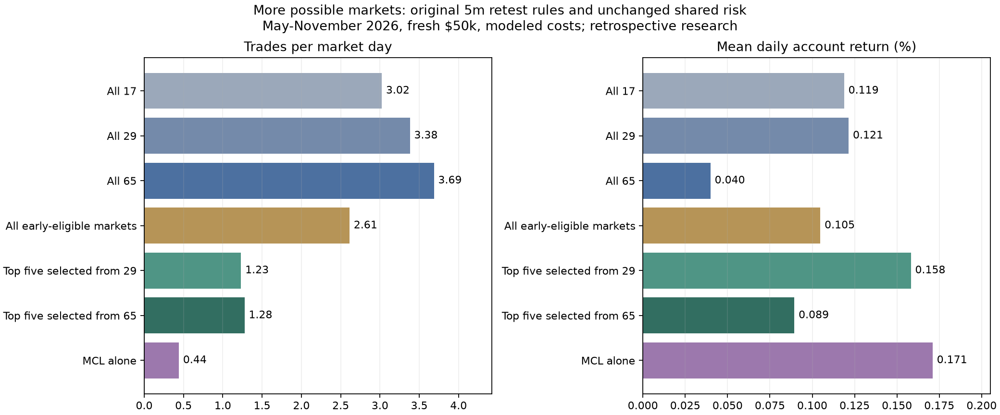

# Expanding the CHoCH universe: 29 to 65 possible assets

Added **36 predefined instruments**, taking the candidate universe to **65**. New names: **GOOGL, AVGO, NFLX, ORCL, CRM, PLTR, COIN, UBER, GS, MS, BAC, C, WMT, COST, HD, LLY, ABBV, JNJ, CAT, DE, GE, BA, INTC, MU, XLK, XLI, XLY, XLP, XLU, XLV, XLB, XLRE, TLT, HYG, EEM, GDX**. Stocks and ETFs cover technology, banks, consumer sectors, healthcare, industrials, utilities, real estate, bonds, international equities and gold miners. This is a chosen surviving-instrument sample, not a point-in-time universe or proof of independent exposures.

Only market membership changes. Keep **5m confirmed-retest / 2R**, original entry windows, first eligible signal per session, two entries per asset/day, 1% planned risk per entry, 2% combined open risk, two simultaneous positions, one equity-index future, 3% daily loss budget, per-asset consecutive-loss halts, and the existing capital reservations. The previous wider-hour/repeated-entry variants are **not** used here.

**Increasing the universe did not improve this historical portfolio.** Moving from 29 to 65 enabled markets increased trades per day from **3.38 to 3.69**, while mean daily return fell from **+0.121% to +0.040%** and maximum minute-mark drawdown rose from **15.86% to 19.56%**. All-65 P&L repriced at the existing higher-cost assumptions is **$-3,931.25**. These results do not support larger membership as a route to a 1%-plus daily average under the fixed risk controls.

## Same-date portfolio results

Period: **1 May-4 November 2026**. Fresh **$50,000** shared accounts and the same **134 observed MNQ market dates**, including zero-trade days. Fees and slippage are modeled. Rows report lower return/trade count/PF/stress and higher minute-mark drawdown across both hypothetical price paths.

| Enabled pool | Enabled assets | Assets actually traded | Trades / market day | Mean daily return | Period return | Maximum minute-mark DD | PF | Fixed-fill stress P&L |
|---|---:|---:|---:|---:|---:|---:|---:|---:|
| All 17 | 17 | 17 | 3.02 | +0.119% | +15.26% | 15.76% | 1.09 | $449.23 |
| All 29 | 29 | 29 | 3.38 | +0.121% | +15.64% | 15.86% | 1.09 | $620.64 |
| All 65 | 65 | 64 | 3.69 | +0.040% | +3.82% | 19.56% | 1.03 | $-3,931.25 |
| All early-eligible markets | 16 | 16 | 2.61 | +0.105% | +13.43% | 17.47% | 1.10 | $2,790.20 |
| Top five selected from 29 | 5 | 5 | 1.23 | +0.158% | +22.68% | 7.42% | 1.38 | $8,833.81 |
| Top five selected from 65 | 5 | 5 | 1.28 | +0.089% | +11.86% | 10.86% | 1.18 | $3,863.01 |
| MCL alone | 1 | 1 | 0.44 | +0.171% | +25.18% | 4.90% | 2.02 | $11,277.00 |

Variants reaching at least 1% arithmetic mean daily account return in both paths: **none**. Daily return is daily P&L divided by prior closing equity, averaged over all market dates. These are not constant daily income rates. Minute marks can miss intraminute drawdowns, and assumed OHLC paths are not observed ticks or confidence bounds.

## Membership experiments

- **All 29 / all 65:** enable the entire predefined available universe without a profitability filter. These directly test adding possible markets with the same execution limits.
- **All early-eligible markets:** **16 assets** passed the unchanged training screen; enable all of them, including multiple candidates in a broad exposure bucket. Portfolio position, index-futures and risk limits still apply. Members: **MNQ, MES, MYM, MCL, AMZN, JPM, UNH, SPY, SLV, ORCL, GS, C, HD, ABBV, MU, XLB**.
- **Top five from 65:** use the existing maximum-five, one-per-exposure-bucket selection rule. Members: **HD, MU, JPM, MCL, MYM**, all 5m.
- **Top five from 29 / all 17 / MCL alone:** unchanged same-date controls from the prior study, reused with explicit journal hashes. The 29-market selected basket was JPM, MCL, MYM, SLV and AMZN. No current-November hindsight watchlist is used.

Selection uses only trades entered and completed **3 November 2025-30 April 2026**. Require each path to have at least 20 early trades, PF >=1.20, positive stressed P&L and at least two positive two-month training blocks. Exclude research roll/end-data liquidations. Rank by the lower mean stressed net R times square root of early trade count, with deterministic alphabetical ties. No later return or target daily profit enters membership scores.

**The year was already inspected.** This is another retrospective experiment. A larger search space increases opportunities for selection bias; a chronological split does not make it an untouched forward test. The ranked five and eligible pool can change composition simply because new candidates enter the same rule. None of these comparisons establishes persistent future profits or an optimal universe size.

## Capital and executable-trade limitations

Scanning 65 markets does not fund 65 positions. Orders compete for the same two position slots, 2% planned open risk and at most 80% pre-entry capital utilization. Same-minute allocation remains alphabetical before any future minute extremes can finance another entry. Actual trade counts can plateau or displace stronger setups as the universe grows; no performance-based order-priority optimization was added.

Futures reserve full initial margin from the existing static broker planning table, not actual historical margin. Stocks/ETFs reserve gross notional, including hypothetical shorts, at no more than 1x account equity. This virtual USD pool does not reconstruct cross-broker buying power, stock borrow availability/charges, cash settlement, margin interest, fixed subscriptions or taxes. It cannot certify live account feasibility. Sparse missing minute buckets are not filled with fabricated bars.

Costs remain futures $0.85/side plus one adverse market tick; shares $0.005/share/fill plus one adverse cent; BTC long-only spot 0.10%/fill plus one basis point. The existing stress reprices identical fills/quantities with higher fees and an extra adverse market tick; it does not resimulate compounding, sizing or allocation. Tagged stale old-contract exits are unverified research marks, not demonstrated market fills. ETF split-adjusted prices and daily-flat positions do not reconstruct a full corporate-action cash ledger.

## Every training candidate

| Asset | Training status | Min early trades | Lower early PF | Score | Failed conditions / bucket |
|---|---|---:|---:|---:|---|
| HD | top five | 27 | 3.28 | 2.953 | consumer |
| XOM | fails | 15 | 6.06 | 2.287 | insufficient_training_trades |
| MU | top five | 27 | 2.68 | 2.044 | technology |
| JPM | top five | 22 | 3.34 | 1.973 | financials |
| SIL | fails | 11 | 2.17 | 1.964 | insufficient_training_trades |
| XLY | fails | 19 | 2.30 | 1.678 | insufficient_training_trades |
| MCL | top five | 39 | 1.70 | 1.636 | oil |
| ORCL | eligible | 24 | 2.12 | 1.613 | technology |
| CAT | fails | 25 | 1.77 | 1.593 | training_time_blocks |
| MYM | top five | 34 | 1.65 | 1.348 | equity_index |
| MES | eligible | 51 | 1.48 | 1.331 | equity_index |
| GE | fails | 16 | 2.72 | 1.204 | insufficient_training_trades |
| MNQ | eligible | 55 | 1.47 | 1.149 | equity_index |
| SPY | eligible | 23 | 1.74 | 0.651 | equity_index |
| C | eligible | 23 | 1.54 | 0.600 | financials |
| SLV | eligible | 26 | 1.39 | 0.561 | silver |
| ABBV | eligible | 23 | 1.31 | 0.474 | healthcare |
| GS | eligible | 25 | 1.26 | 0.440 | financials |
| GOOGL | fails | 17 | 1.70 | 0.386 | insufficient_training_trades |
| COIN | fails | 28 | 1.15 | 0.368 | training_profit_factor |
| AMZN | eligible | 25 | 1.39 | 0.325 | consumer |
| BA | fails | 27 | 1.17 | 0.272 | training_profit_factor, training_time_blocks |
| UNH | eligible | 33 | 1.31 | 0.259 | healthcare |
| XLF | fails | 15 | 1.93 | 0.004 | insufficient_training_trades |
| XLV | fails | 12 | 1.22 | -0.041 | insufficient_training_trades |
| TSLA | fails | 26 | 1.13 | -0.108 | training_profit_factor |
| MSFT | fails | 22 | 0.65 | -0.113 | training_cost_stress, training_profit_factor |
| XLB | eligible | 23 | 1.53 | -0.120 | materials |
| LLY | fails | 29 | 0.79 | -0.183 | training_cost_stress, training_profit_factor, training_time_blocks |
| WMT | fails | 18 | 1.24 | -0.190 | insufficient_training_trades |
| CVX | fails | 25 | 0.68 | -0.212 | training_cost_stress, training_profit_factor |
| IWM | fails | 22 | 1.17 | -0.308 | training_profit_factor, training_time_blocks |
| CRM | fails | 31 | 0.87 | -0.347 | training_cost_stress, training_profit_factor |
| MS | fails | 22 | 0.75 | -0.433 | training_cost_stress, training_profit_factor |
| USO | fails | 10 | 0.91 | -0.439 | insufficient_training_trades, training_cost_stress, training_profit_factor, training_time_blocks |
| AAPL | fails | 22 | 0.77 | -0.483 | training_cost_stress, training_profit_factor, training_time_blocks |
| UBER | fails | 23 | 0.80 | -0.628 | training_cost_stress, training_profit_factor |
| JNJ | fails | 28 | 0.70 | -0.629 | training_cost_stress, training_profit_factor, training_time_blocks |
| NVDA | fails | 24 | 0.88 | -0.638 | training_cost_stress, training_profit_factor |
| BAC | fails | 17 | 0.78 | -0.670 | insufficient_training_trades, training_cost_stress, training_profit_factor, training_time_blocks |
| XLP | fails | 20 | 0.57 | -0.693 | training_cost_stress, training_profit_factor, training_time_blocks |
| PLTR | fails | 30 | 0.78 | -0.714 | training_cost_stress, training_profit_factor, training_time_blocks |
| GDX | fails | 23 | 0.80 | -0.771 | training_cost_stress, training_profit_factor |
| XLK | fails | 23 | 0.67 | -0.938 | training_cost_stress, training_profit_factor, training_time_blocks |
| XLE | fails | 24 | 0.75 | -0.964 | training_cost_stress, training_profit_factor, training_time_blocks |
| GLD | fails | 21 | 0.41 | -1.112 | training_cost_stress, training_profit_factor, training_time_blocks |
| AVGO | fails | 25 | 0.61 | -1.195 | training_cost_stress, training_profit_factor, training_time_blocks |
| COST | fails | 28 | 0.70 | -1.207 | training_cost_stress, training_profit_factor, training_time_blocks |
| XLU | fails | 23 | 0.76 | -1.216 | training_cost_stress, training_profit_factor, training_time_blocks |
| TLT | fails | 25 | 0.85 | -1.249 | training_cost_stress, training_profit_factor, training_time_blocks |
| DE | fails | 21 | 0.51 | -1.266 | training_cost_stress, training_profit_factor, training_time_blocks |
| EEM | fails | 20 | 0.67 | -1.432 | training_cost_stress, training_profit_factor |
| XLRE | fails | 18 | 0.60 | -1.432 | insufficient_training_trades, training_cost_stress, training_profit_factor, training_time_blocks |
| INTC | fails | 17 | 0.41 | -1.475 | insufficient_training_trades, training_cost_stress, training_profit_factor, training_time_blocks |
| M6E | fails | 13 | 0.45 | -1.499 | insufficient_training_trades, training_cost_stress, training_profit_factor, training_time_blocks |
| XLI | fails | 23 | 0.63 | -1.548 | training_cost_stress, training_profit_factor, training_time_blocks |
| QQQ | fails | 21 | 0.51 | -1.701 | training_cost_stress, training_profit_factor, training_time_blocks |
| NFLX | fails | 24 | 0.42 | -1.709 | training_cost_stress, training_profit_factor, training_time_blocks |
| META | fails | 16 | 0.27 | -1.789 | insufficient_training_trades, training_cost_stress, training_profit_factor, training_time_blocks |
| COP | fails | 25 | 0.29 | -2.000 | training_cost_stress, training_profit_factor, training_time_blocks |
| AMD | fails | 23 | 0.33 | -2.285 | training_cost_stress, training_profit_factor, training_time_blocks |
| HYG | fails | 15 | 0.35 | -2.499 | insufficient_training_trades, training_cost_stress, training_profit_factor, training_time_blocks |
| MGC | fails | 57 | 0.52 | -2.568 | training_cost_stress, training_profit_factor, training_time_blocks |
| BTCUSD | fails | 39 | 0.77 | -2.658 | training_cost_stress, training_profit_factor, training_time_blocks |
| M2K | fails | 41 | 0.43 | -2.829 | training_cost_stress, training_profit_factor, training_time_blocks |

## Data, performance equivalence and audit

The original 29 candidate datasets and journals remain unchanged. The additional 36 use Massive's existing stock entitlement. A successful historical minute-data probe beyond the Basic two-year window supports paid-stock-tier access; [official paid stock plans permit unlimited calls](https://massive.com/pricing?product=stocks). This is an inference from entitlement, not a billing lookup. A stock-only paced client shares request slots, uses at most one scheduled request per second across three download threads, and falls back to conservative pacing after HTTP429. No subscription or purchase was changed. Futures/crypto defaults remain unchanged.

Larger portfolios use an equivalent accounting index over active positions instead of repeatedly scanning every enabled instrument. It preserves original engine order, marks, fees, allocation timing and risk arithmetic. **Both baseline price paths matched all 165 trades and 134 daily marks exactly** before larger portfolio comparisons ran. Runtime source hashes and the [control evidence](research/results/universe65_runtime_controls.json) are retained alongside the original model hashes.

**142 tests passed.** Audited 130 candidate cases (**58 reused**), eight new shared-account cases, six reused same-date portfolio controls and **10,932 simulated trade executions** in those records. Checks cover completed-training eligibility, exact reused journals, pivot timing, planned risk, modeled fees, ledger reconciliation, daily compounding, shared-account position limits and input/source hashes. Every modeled entry fill also matched its raw minute open plus the declared slippage across **3,370 unique asset/contract/entry-minute keys**. These establish stated mechanics, not predictive validity. Unavailable candidates: **none**.

Reproduce with `python -m research.universe65_download`, `python -m research.universe65_fast --workers 3`, then `python -m research.universe65_report`. [Protocol](research/universe65_protocol.json), [selection](research/results/universe65_selection.json), [summary](research/results/universe65_summary.json), [candidate journals](research/results/universe65_candidates) and [portfolio journals](research/results/universe65_portfolios) retain all cases and fingerprints. Raw prices, API caches and logs stay local and ignored. This research does not change default paper/live strategy settings or submit orders.
